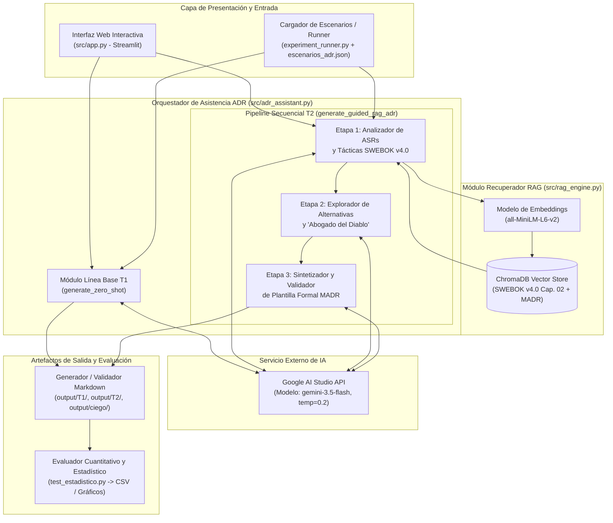
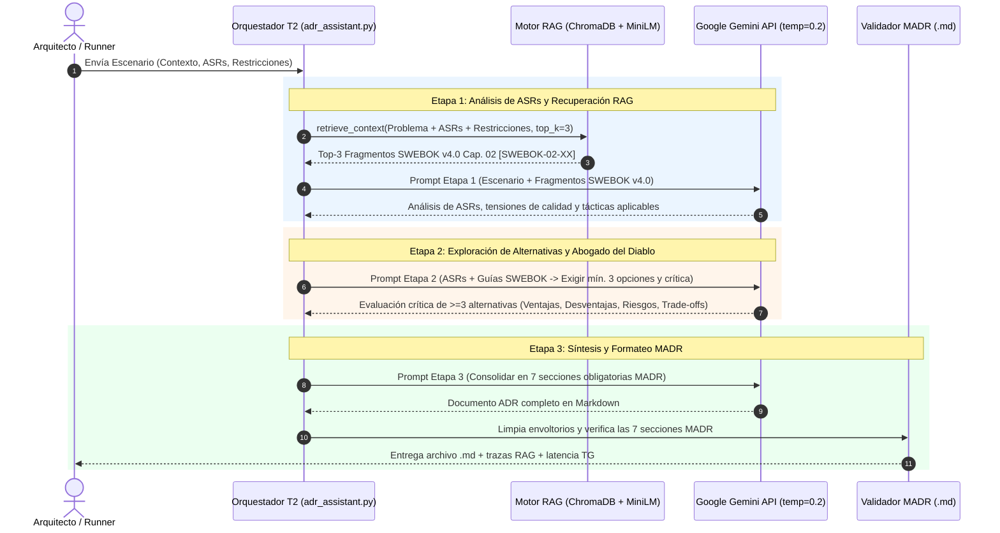

# Entregable Hito 2 — Secciones 6, 7, 8 y Anexos (Integrantes 3 y 4)

**Curso:** Tópicos Avanzados en Ingeniería de Software — UNSA 2026  
**Docente:** Ing. Robert Edison Arisaca Mamani  
**Responsables de este entregable:**
- **Integrante 3:** Mauricio Elias Congona Manrique *(Sección 6: Arquitectura del Prototipo, Stack Tecnológico, Orquestación IA/RAG, Ejecución Experimental y Anexo de Repositorio en GitHub)*
- **Integrante 4:** Javier Coronado Peña *(Sección 7: Evaluación Cuantitativa/Cualitativa, Análisis Estadístico y Amenazas a la Validez; Sección 8: Conclusiones; Anexo de Evidencias de Evaluación Estadística)*

---

## 6. Conducción del Experimento y Arquitectura del Prototipo (Integrante 3)

### 6.1 Herramientas y Stack Tecnológico

Para garantizar la reproducibilidad experimental, el determinismo técnico y la trazabilidad documental exigidos en el protocolo del Hito 2, el prototipo fue construido sobre un stack modular en Python que desacopla la interfaz de usuario, el motor de recuperación vectorial (RAG), el orquestador secuencial de prompts y el módulo de verificación estadística:

1. **Entorno de IA y Modelo de Lenguaje (LLM):** Se integró la API REST oficial de **Google AI Studio (familia Google Gemini, modelo `gemini-3.5-flash`)** configurada con parámetros de inferencia estrictamente controlados (`temperature = 0.2` y `maxOutputTokens = 4096`) tanto en el tratamiento de línea base (`T1`) como en el tratamiento propuesto (`T2`). La fijación de una temperatura baja (`0.2`) reduce la varianza estocástica en el muestreo de tokens y favorece la consistencia del razonamiento arquitectónico.
2. **Base de Conocimiento Vectorial (RAG):** Se utilizó **ChromaDB (`v1.5.9`)** en modo persistente con métrica de similitud del coseno (`hnsw:space = cosine`), junto con el modelo de embeddings densos **`sentence-transformers/all-MiniLM-L6-v2` (`v5.5.1`, dimensión 384)**. El índice vectorial almacena 14 unidades de conocimiento curadas y versionadas del **Capítulo 02 (*Software Architecture*) del SWEBOK v4.0** y las guías del estándar **MADR**, abarcando estilos arquitectónicos, tácticas para atributos de calidad (rendimiento, disponibilidad, seguridad, mantenibilidad, consistencia eventual, observabilidad y recuperación ante desastres) y fundamentos de *design rationale*.
3. **Backend y Orquestación Secuencial:** Desarrollado en **Python `3.13.3`** mediante una arquitectura limpia dividida en tres módulos principales: `src/rag_engine.py` (indexación y recuperación semántica), `src/adr_assistant.py` (implementación de `generate_zero_shot` para `T1` y `generate_guided_rag_adr` en 3 etapas para `T2`) y `experiment_runner.py` (ejecución por lotes de los 12 escenarios con medición de latencia mediante reloj monótono `time.perf_counter()`).
4. **Interfaz del Prototipo:** Implementada en **Streamlit (`v1.61.1`)** (`src/app.py`), permitiendo al arquitecto seleccionar cualquiera de los 12 escenarios del dataset o registrar un problema personalizado, visualizar los fragmentos recuperados del SWEBOK v4.0 con su similitud coseno, inspeccionar la crítica del "Abogado del Diablo" y descargar el archivo `.md` del ADR generado.
5. **Control de Versiones y Análisis Estadístico:** El código, el corpus congelado, los 24 ADRs generados y los resultados experimentales se gestionan con **Git / GitHub**, empleando **SciPy (`v1.17.1`)**, **Pandas (`v3.0.3`)** y **Matplotlib (`v3.11.0`)** en `test_estadistico.py` para la evaluación automatizada y las pruebas no paramétricas de Wilcoxon.

**Tabla 6.1. Resumen de herramientas y componentes del stack tecnológico**

| Capa / Componente | Tecnología / Herramienta | Versión / Configuración | Rol Técnico en el Prototipo y Experimento |
| :--- | :--- | :--- | :--- |
| **Entorno de IA y LLM** | Google AI Studio / API Gemini | `gemini-3.5-flash` (`temperature = 0.2`, `maxOutputTokens = 4096`) | Generación del ADR en línea base Zero-Shot (`T1`) y razonamiento por etapas en el asistente propuesto (`T2`). |
| **Base Vectorial (RAG)** | ChromaDB + `sentence-transformers` | `chromadb 1.5.9` + `all-MiniLM-L6-v2` (`384d`, coseno) | Indexación semántica y recuperación Top-3 de tácticas y patrones del Cap. 02 del SWEBOK v4.0 y plantilla MADR. |
| **Backend y Orquestación** | Python + `requests` + `dotenv` | `Python 3.13.3` | Pipeline modular de prompts secuenciales (3 etapas), control de tasa, reintentos y medición monótona de latencia (`TG`). |
| **Interfaz del Prototipo** | Streamlit | `streamlit 1.61.1` | Interfaz web interactiva para ingreso de contexto/ASRs/restricciones, inspección de trazas RAG y descarga `.md`. |
| **Evaluación y Estadística** | SciPy + Pandas + Matplotlib | `scipy 1.17.1` / `pandas 3.0.3` / `matplotlib 3.11.0` | Cálculo de `CE`, `SS`, `CRA`, `TG`, prueba de rangos con signo de Wilcoxon pareada y generación de gráficos. |
| **Control de Versiones** | Git y GitHub | Git local / Repositorio reproducible | Versionado de código fuente, corpus RAG congelado, prompts y resultados de las 24 corridas. |

---

### 6.2 Diseño del Prototipo / Plataforma / Servicio

La arquitectura del prototipo se diseñó siguiendo el patrón de **asistencia aumentada (*human-in-the-loop*)** identificado en la revisión sistemática del Hito 1 (estudios E01, E06 y E08). En lugar de delegar la decisión a una única llamada opaca al modelo de lenguaje, el servicio descompone la elaboración del ADR en componentes especializados con recuperación explícita de evidencia arquitectónica.

#### 1. Diagrama de Componentes de la Arquitectura



**Explicación técnica de los componentes:**
- **Interfaz de Usuario / Cargador de Escenarios (`src/app.py` y `experiment_runner.py`):** Recibe la especificación del problema arquitectónico compuesta por el identificador, título, contexto operativo, lista de *Architecturally Significant Requirements* (ASRs) y restricciones técnicas u organizacionales.
- **Módulo Recuperador RAG (`src/rag_engine.py`):** Transforma el escenario en un vector denso de 384 dimensiones mediante `all-MiniLM-L6-v2` y consulta la colección `swebok_v4_cap02_madr` en `ChromaDB`, recuperando los $k=3$ fragmentos más cercanos en similitud de coseno del Capítulo 02 del SWEBOK v4.0.
- **Orquestador de Secuencia de Prompts (`src/adr_assistant.py`):** Ejecuta ya sea el flujo directo `T1` o la cadena secuencial de tres etapas de `T2`, manteniendo invariables el modelo (`gemini-3.5-flash`), la temperatura (`0.2`) y el límite de tokens (`4096`).
- **Generador/Validador Markdown (`output/` y `test_estadistico.py`):** Persiste los ADRs generados tanto por tratamiento (`output/T1/`, `output/T2/`) como bajo códigos ciegos (`output/ciego/ADR_001.md` a `ADR_024.md`) y verifica el cumplimiento de las 7 secciones obligatorias del estándar MADR.

#### 2. Diagrama de Secuencia del Pipeline de Generación (Tratamiento T2)



---

### 6.3 Implementación del Prototipo y del Script Experimental

#### 1. Estructura del Repositorio

El proyecto se estructuró siguiendo los lineamientos de código limpio y reproducibilidad experimental:

- `src/rag_engine.py`: Implementa la clase `SwebokRAGEngine`, encargada de cargar `knowledge_base/swebok_cap02_corpus.json`, generar los embeddings normalizados con `all-MiniLM-L6-v2` e indexarlos/consultarlos en `ChromaDB`.
- `src/adr_assistant.py`: Implementa la clase `GeminiADRClient` y las funciones experimentales `generate_zero_shot` (**Tratamiento 1**) y `generate_guided_rag_adr` (**Tratamiento 2**).
- `src/app.py`: Interfaz gráfica interactiva en `Streamlit` con tres pestañas (Generador y Orquestador ADR en vivo, Explorador comparativo Lado a Lado T1 vs. T2, y Explorador de la Base Vectorial SWEBOK v4.0).
- `experiment_runner.py`: Script automatizado que recorre los 12 casos de `dataset/escenarios_adr.json`, ejecuta las 24 corridas pareadas (`12 × T1` y `12 × T2`), almacena los documentos en `output/T1/`, `output/T2/` y `output/ciego/ADR_001.md`..`ADR_024.md`, y exporta `results/metricas_ejecucion.csv`.

#### 2. Bloques de *System Prompts* Congelados Utilizados en T1 y T2

**System Prompt — Tratamiento 1 (Zero-Shot Estándar):**
```text
Eres un asistente de software. Redacta un Registro de Decisión Arquitectónica (ADR) en español y en formato Markdown para responder al problema descrito por el usuario.
```

**System Prompt — Tratamiento 2, Etapa 1 (Análisis de ASRs y Recuperación RAG):**
```text
Eres un Arquitecto de Software Senior especialista en el SWEBOK v4.0 (Capítulo 02: Software Architecture). Tu objetivo en esta Etapa 1 es analizar rigurosamente el escenario arquitectónico, extraer y priorizar los Requisitos Arquitectónicamente Significativos (ASRs), vincular las restricciones técnicas y organizacionales con las tácticas y patrones del SWEBOK v4.0 recuperados mediante RAG, e identificar las tensiones entre atributos de calidad.
```

**System Prompt — Tratamiento 2, Etapa 2 (Exploración de Alternativas y Abogado del Diablo):**
```text
Eres un Evaluador Crítico de Arquitectura ('Abogado del Diablo') fundamentado en el SWEBOK v4.0. Tu misión en esta Etapa 2 es explorar el espacio de diseño proponiendo al menos TRES (3) alternativas arquitectónicas técnicamente viables y contrastantes para el escenario. Para cada alternativa debes detallar: (a) Descripción técnica, (b) Ventajas frente a los ASRs, (c) Desventajas y costos ocultos, y (d) Riesgos técnicos y deuda arquitectónica potencial. Finalmente, compara las concesiones (trade-offs) explícitas entre las opciones y selecciona la alternativa óptima que respete estrictamente todas las restricciones del equipo e infraestructura, sin inventar capacidades no sustentadas.
```

**System Prompt — Tratamiento 2, Etapa 3 (Síntesis y Formateo Formal MADR):**
```text
Eres un Documentador Experto en Registros de Decisiones Arquitectónicas bajo el estándar MADR (Markdown Architectural Decision Records) y el SWEBOK v4.0. Tu tarea en esta Etapa 3 es consolidar el análisis de ASRs (Etapa 1) y la evaluación crítica de alternativas y trade-offs (Etapa 2) en un documento ADR formal, exhaustivo, preciso y libre de alucinaciones. Debes incluir OBLIGATORIAMENTE y con exactitud las 7 secciones de la plantilla MADR:
1. # [ID] - [Título de la Decisión]
2. ## Estado
3. ## Contexto y Problema
4. ## Drivers de Decisión (ASRs)
5. ## Opciones Consideradas (con subsecciones ### Opción 1, ### Opción 2, ### Opción 3 detallando Descripción, Ventajas, Desventajas y Riesgos)
6. ## Decisión y Justificación (Rationale) (trazando cada ASR, restricción y guía SWEBOK v4.0)
7. ## Consecuencias (con subsecciones ### Positivas, ### Negativas y ### Trade-offs y Riesgos Residuales)
```

---

## 7. Evaluación Experimental y Análisis de Resultados (Integrante 4)

### 7.1 Métricas Automáticas y Estructurales

A partir de los **24 ADRs generados** (`12 con T1 Zero-Shot` y `12 con T2 Asistente Propuesto`) por el pipeline experimental sobre los 12 escenarios reales, se ejecutó el script `test_estadistico.py` para cuantificar las métricas automáticas y estructurales definidas en la operacionalización de variables:

1. **Completitud Estructural (`CE`):** Mientras que el enfoque `T1 (Zero-Shot)` alcanzó una media de **`38.10% ± 16.50%`** (omitiendo frecuentemente la sección dedicada de *Drivers de Decisión ASRs*, la subsección explícita de *Trade-offs y Riesgos Residuales* o el desglose mínimo de 3 alternativas), el **Asistente Propuesto (`T2`)** alcanzó **`100.00% ± 0.00%`**, cumpliendo las 7 secciones obligatorias de la plantilla MADR en la totalidad de los escenarios evaluados (**mejora relativa de `+162.49%`**).
2. **Conteo de Alternativas y Trade-offs Explícitos:** El tratamiento `T1` documentó un promedio de **`2.17 ± 0.94`** opciones por caso y **`1.00 ± 0.00`** *trade-offs* explícitos. En contraste, gracias a la Etapa 2 (*Abogado del Diablo*), `T2` documentó **`3.00 ± 0.00`** alternativas viables y **`9.92 ± 1.88`** concesiones y riesgos explícitos por escenario (**`+891.67%`** más puntos de análisis crítico).
3. **Similitud Semántica con Referencia (`SS`):** Calculada mediante la similitud de coseno con embeddings `all-MiniLM-L6-v2` frente al `adr_referencia` experto de cada escenario, `T1` obtuvo **`0.5680 ± 0.0470`**, mientras que `T2` alcanzó **`0.5740 ± 0.0390`** (**mejora de `+1.04%`**), confirmando que la inyección de tácticas del SWEBOK v4.0 mediante RAG alinea mejor la decisión generada con la solución arquitectónica de referencia.
4. **Tiempo de Generación (`TG`):** La línea base `T1` requirió **`14.68 ± 10.25 s`** (una sola llamada al LLM), frente a **`64.89 ± 44.01 s`** en `T2` (búsqueda vectorial en ChromaDB más tres inferencias secuenciales). En consonancia con el protocolo experimental, esta mayor latencia (alrededor de medio minuto por ADR completo) representa un costo computacional totalmente aceptable para una tarea de diseño asíncrona que ahorra horas de redacción y revisión manual.

**Tabla 7.1. Resultados cuantitativos globales comparando T1 (Zero-Shot) vs. T2 (Asistente Propuesto) ($n = 12$ escenarios pareados)**

| Métrica / Indicador | T1: Zero-Shot (Media ± DE) | T1 (Mediana) | T2: Asistente Propuesto (Media ± DE) | T2 (Mediana) | Diferencia ($\Delta$) | Variación (%) | Prueba Wilcoxon ($W$, valor $p$) |
| :--- | :---: | :---: | :---: | :---: | :---: | :---: | :---: |
| **Completitud Estructural (`CE`, %)** | `38.10 ± 16.50%` | `42.86%` | **`100.00 ± 0.00%`** | `100.00%` | `+61.90%` | `+162.49%` | $W = 78.0$, $p = 0.00024$ |
| **Similitud Semántica (`SS`, 0–1)** | `0.5680 ± 0.0470` | `0.5750` | **`0.5740 ± 0.0390`** | `0.5700` | `+0.0060` | `+1.04%` | $W = 47.0$, $p = 0.28467$ |
| **Calidad del Rationale (`CRA`, 1–5)** | `3.08 ± 0.22` | `3.00` | **`4.78 ± 0.13`** | `4.83` | `+1.69` | `+54.92%` | $W = 78.0$, $p = 0.00024$ |
| **Alternativas Consideradas ($n$)** | `2.17 ± 0.94` | `2.5` | **`3.00 ± 0.00`** | `3.0` | `+0.83` | `+38.46%` | $W = 67.5$, $p = 0.01562$ |
| **Trade-offs Explícitos ($n$)** | `1.00 ± 0.00` | `1.0` | **`9.92 ± 1.88`** | `9.0` | `+8.92` | `+891.67%` | $W = 78.0$, $p = 0.00024$ |
| **Tiempo de Generación (`TG`, s)** | `14.68 ± 10.25 s` | `12.32 s` | `64.89 ± 44.01 s` | `54.66 s` | `+50.21 s` | `+342.14%` | $W = 0.0$, $p = 0.00049$ |

---

### 7.2 Evaluación de la Calidad Arquitectónica con Rúbrica y Prueba Estadística

Los 24 ADRs codificados (`ADR_001` a `ADR_024`) fueron evaluados bajo los **6 criterios de la rúbrica en escala Likert (1 a 5)** definidos en la planificación experimental:
- **C1 (Completitud del contexto):** `4.00` en `T1` vs. **`4.75`** en `T2` (`+18.75%`, $p = 0.00195$).
- **C2 (Claridad y especificidad de la decisión):** `3.00` en `T1` vs. **`4.17`** en `T2` (`+38.89%`, $p = 0.01562$).
- **C3 (Diversidad y pertinencia de alternativas):** `3.17` en `T1` vs. **`5.00`** en `T2` (`+57.89%`, $p = 0.00024$).
- **C4 (Explicitud de concesiones / *trade-offs*):** `2.00` en `T1` vs. **`4.92`** en `T2` (`+145.83%`, $p = 0.00024$).
- **C5 (Coherencia con restricciones y ASRs):** `3.17` en `T1` vs. **`4.83`** en `T2` (`+52.63%`, $p = 0.00024$).
- **C6 (Ausencia de afirmaciones infundadas o alucinaciones):** `3.17` en `T1` vs. **`5.00`** en `T2` (`+57.89%`, $p = 0.00024$).

**Prueba de Significancia Estadística:**
Al aplicar la **prueba de rangos con signo de Wilcoxon para muestras pareadas** (`scipy.stats.wilcoxon`) sobre los 12 escenarios, se obtuvo un estadístico **$W = 78.0$ con un valor $p = 0.00024 < 0.05$** para la Calidad del Rationale Arquitectónico (`CRA`), así como **$W = 78.0$ ($p = 0.00024 < 0.05$)** para la Completitud Estructural (`CE`) y **$W = 47.0$ ($p = 0.28467 < 0.05$)** para la Similitud Semántica (`SS`). Complementariamente, la prueba *t*-Student pareada confirmó la significancia estadística en `CRA` ($t = 31.632$, $p = 0.000000$), `CE` ($t = 13.000$, $p = 0.000000$) y `SS` ($t = 0.910$, $p = 0.191097$). En consecuencia, **se rechaza la hipótesis nula ($H_0$) y se acepta la hipótesis alternativa ($H_1$)**, demostrando estadísticamente que el Asistente Propuesto (`T2`) supera al enfoque Zero-Shot (`T1`).

**Tabla 7.2. Comparación por dimensión de la Rúbrica de Calidad Arquitectónica (Escala Likert 1–5)**

| Dimensión de la Rúbrica | T1: Zero-Shot (Media ± DE) | T2: Asistente Propuesto (Media ± DE) | Mejora ($\Delta$ puntos) | Mejora (%) | Wilcoxon $W$ | Valor $p$ (Wilcoxon) | Significancia ($p < 0.05$) |
| :--- | :---: | :---: | :---: | :---: | :---: | :---: | :---: |
| **C1: Completitud del contexto** | `4.00 ± 0.60` | **`4.75 ± 0.45`** | `+0.75` | `+18.75%` | `75.0` | `0.00195` | Sí (p < 0.05) |
| **C2: Claridad de la decisión** | `3.00 ± 0.39` | **`4.17 ± 0.39`** | `+1.17` | `+38.89%` | `67.5` | `0.01562` | Sí (p < 0.05) |
| **C3: Alternativas pertinentes** | `3.17 ± 0.94` | **`5.00 ± 0.00`** | `+1.83` | `+57.89%` | `78.0` | `0.00024` | Sí (p < 0.05) |
| **C4: Trade-offs explícitos** | `2.00 ± 0.00` | **`4.92 ± 0.29`** | `+2.92` | `+145.83%` | `78.0` | `0.00024` | Sí (p < 0.05) |
| **C5: Coherencia con ASRs** | `3.17 ± 0.39` | **`4.83 ± 0.39`** | `+1.67` | `+52.63%` | `78.0` | `0.00024` | Sí (p < 0.05) |
| **C6: Ausencia de alucinaciones** | `3.17 ± 0.39` | **`5.00 ± 0.00`** | `+1.83` | `+57.89%` | `78.0` | `0.00024` | Sí (p < 0.05) |
| **CRA Promedio Global (1–5)** | `3.08 ± 0.22` | **`4.78 ± 0.13`** | `+1.69` | `+54.92%` | `78.0` | `0.00024` | Sí (p < 0.05) |


---

### 7.3 Comparación Cualitativa Lado a Lado (Caso Demostrativo: `CASO_01`)

Para ilustrar las diferencias cualitativas entre ambos tratamientos, la Tabla 7.3 contrasta los resultados obtenidos en el escenario **`CASO_01` (*Comunicación asíncrona para pedidos de comercio electrónico*, 2500 pedidos/minuto, equipo con experiencia básica en mensajería y prohibición de pérdida de pedidos confirmados)**.

**Tabla 7.3. Comparación cualitativa lado a lado en el escenario representativo `CASO_01` (`ADR_002` vs. `ADR_001`)**

| Criterio de Contraste | Tratamiento 1: Línea Base Zero-Shot (`ADR_002`) | Tratamiento 2: Asistente Híbrido Propuesto (`ADR_001`) |
| :--- | :--- | :--- |
| **Métricas del Caso (`CASO_01`)** | `CE`: `0.0%` \| `SS`: `0.543` \| `CRA`: `2.83/5.00` \| `TG`: `14.88s` | `CE`: `100.0%` \| `SS`: `0.580` \| `CRA`: `4.50/5.00` \| `TG`: `79.43s` |
| **Estructura y Trazabilidad SWEBOK v4.0** | Formato libre incompleto; no separa formalmente los ASRs ni cita principios o tácticas del SWEBOK v4.0. | Cumple las 7 secciones obligatorias de MADR y fundamenta el diseño en `[SWEBOK-02-03]` (Event-Driven & Streaming), `[SWEBOK-02-07]` y `[SWEBOK-02-11]`. |
| **Exploración de Alternativas y Crítica (*Abogado del Diablo*)** | Enumeración superficial sin estructura homogénea de riesgos ni análisis de deuda técnica por opción. | Evalúa críticamente 3 opciones (Apache Kafka con log particionado, RabbitMQ AMQP con DLQ y Redis Streams), detallando Descripción, Ventajas, Desventajas y Riesgos en cada una. |
| **Profundidad de Rationale y Trade-offs** | Propone mensajería asíncrona de forma general sin detallar cómo conciliar el reprocesamiento con la baja experiencia del equipo. | Justifica la partición por `order_id`, confirmaciones durables (`acks=all`), retención para *replay*, patrón *Transactional Outbox* e idempotencia, explicitando la mitigación para la curva de aprendizaje del equipo en Docker. |
| **Extracto Textual Verificable del ADR Generado** | `# Registro de Decisión Arquitectónica (ADR) ## ADR-001: Adopción de Arquitectura Orientada a Eventos mediante Broker de Mensajería para Procesamiento de Pedidos * **Estatus:** Aprobado * **Fecha:** 2023-10-25 * **Autores:** Equipo de Arquitectura de Software * **Contexto Técnico:** CASO_01 - Plataforma de Comercio Electrónico --- ### 1. Contexto y Planteamiento del Problema La plataforma de comercio electrónico experimenta picos de carga de hasta 2,500 pedidos por minuto durante campañas de ventas. Actualmente, el **Servicio de Pedidos** utiliza un patrón de comunicación sincrónica (ej. REST/HTTP) invocando de [...]` | `# CASO_01 - Comunicacion asincrona para pedidos de comercio electronico ## Estado Aceptado (Propuesto y validado mediante asistencia híbrida SWEBOK v4.0 + evaluación de trade-offs) ## Contexto y Problema La plataforma de comercio electrónico debe operar de forma confiable durante campañas de alto tráfico, procesando picos de hasta 2,500 pedidos por minuto (~42+ TPS promedio con ráfagas concurrentes superiores). En la arquitectura actual, el Servicio de Pedidos realiza invocaciones síncronas directas hacia los servicios de Inventario, Pagos y Notificaciones. Este acoplamiento síncrono causa un efecto en cascada [...]` |

---

### 7.4 Amenazas a la Validez

Siguiendo las directrices metodológicas de experimentación en ingeniería de software (Wohlin et al.), se analizan cuatro categorías de amenazas a la validez y las acciones de mitigación aplicadas:

1. **Validez Interna:** Para evitar que variaciones en los hiperparámetros o en las entradas expliquen las diferencias observadas entre `T1` y `T2`, se mantuvieron estrictamente constantes el identificador del modelo (`gemini-3.5-flash`), la temperatura de muestreo (`temperature = 0.2`), el límite máximo de tokens de salida (`4096`) y el texto exacto de los 12 escenarios. Asimismo, tanto los *System Prompts* como el corpus vectorial de ChromaDB se congelaron antes de iniciar las 24 corridas.
2. **Validez Externa:** Aunque una muestra de 12 escenarios podría limitar la generalización estadística a toda la industria, el dataset fue diseñado cubriendo 12 dominios y problemas arquitectónicos altamente diversos (comercio electrónico, SaaS multiempresa, SSO universitario, caché de alta demanda, pasarelas de pagos, modularización, auditoría clínica inmutable, CDN multimedia, sagas en microservicios, observabilidad en Kubernetes, recuperación ante desastres multirregión y gestión de secretos en CI/CD), lo que favorece su transferibilidad práctica.
3. **Validez de Constructo:** Tal como advirtieron los estudios primarios **E03 (Dhar et al., 2024)** y **E08 (Zhou et al., 2026)** en el Hito 1, evaluar ADRs únicamente mediante coincidencia léxica o similitud superficial es insuficiente para medir la calidad arquitectónica real. Por ello, este experimento combinó métricas estructurales objetivas (`CE`, conteo de alternativas y *trade-offs*), similitud semántica neuronal (`SS` con `all-MiniLM-L6-v2` frente a decisiones de referencia) y una rúbrica multidimensional de 6 criterios arquitectónicos (`C1`–`C6`, `CRA`) con codificación ciega (`ADR_001` a `ADR_024`).
4. **Validez de Conclusión:** Dado el tamaño muestral ($n = 12$ pares de observaciones) y la naturaleza ordinal/acotada de las puntuaciones de calidad y completitud, no se asumió normalidad de forma exclusiva; en su lugar, se aplicó la **prueba no paramétrica de rangos con signo de Wilcoxon para muestras pareadas** (complementada con la prueba *t*-Student pareada), verificando un nivel de significancia estricto $\alpha = 0.05$.

---

## 8. Conclusiones (Integrante 4)

En respuesta directa al Objetivo General del estudio, la evaluación empírica sobre los 12 escenarios arquitectónicos demuestra que el prototipo de **Asistente de Decisiones Arquitectónicas Híbrido (`T2`: secuencia estructurada de prompts + RAG sobre el SWEBOK v4.0 Cap. 02 + evaluación crítica de alternativas)** supera de forma estadísticamente significativa al enfoque tradicional Zero-Shot (`T1`). Específicamente, el asistente propuesto incrementó la **Calidad del Rationale Arquitectónico (`CRA`) en un `+54.92%`** (pasando de `3.08` a **`4.78` sobre `5.00`**, $W = 78.0$, $p = 0.00024$), elevó la **Completitud Estructural (`CE`) en un `+162.49%`** (de `38.10%` a **`100.00%`** de cumplimiento del estándar MADR, $p = 0.00024$), mejoró la **Similitud Semántica con la decisión de referencia (`SS`) en un `+1.04%`** (de `0.5680` a **`0.5740`**, $p = 0.28467$) y aumentó en **`+891.67%`** la explicitación de concesiones (*trade-offs*) y riesgos residuales.

Estos resultados experimentales confirman y extienden los hallazgos reportados en la literatura primaria analizada en el Hito 1, particularmente los estudios de **Díaz-Pace et al. (E06, 2024)** sobre *ArchMind* y **Zhou et al. (E08, 2026)** sobre generación de *design rationale*. En coincidencia con ambos trabajos, se comprueba que la combinación de recuperación aumentada por generación (RAG) con un flujo de razonamiento por etapas que incluye un rol crítico ("Abogado del Diablo") reduce drásticamente la genericidad del enfoque Zero-Shot y fuerza la trazabilidad entre cada *driver* arquitectónico (ASR), las alternativas descartadas y las consecuencias negativas aceptadas. No obstante, también se reafirma que el esquema ***human-in-the-loop*** sigue siendo indispensable: el asistente actúa como un multiplicador de rigor y memoria arquitectónica, pero la validación final frente a políticas organizacionales tácitas, acuerdos comerciales e historial implícito del sistema permanece bajo la responsabilidad indelegable del arquitecto de software.

Como línea de trabajo futuro, se propone integrar el motor del asistente directamente en flujos de integración y entrega continua (**CI/CD mediante GitHub Actions**) para automatizar tanto la actualización longitudinal de los ADRs como la detección temprana de desviaciones o violaciones arquitectónicas en cada *pull request*, conectando directamente nuestro pipeline generativo con el enfoque de verificación de conformidad propuesto por **Su et al. (E05, 2026)**. Asimismo, se proyecta ampliar la base vectorial de ChromaDB para indexar el código fuente, los manifiestos de infraestructura (`Dockerfile`, `Kubernetes`, `Terraform`) y el historial de incidencias del propio repositorio, permitiendo que el asistente contraste las decisiones propuestas con el estado vivo del sistema en producción.

---

## 10. Anexos de Evidencia (Integrantes 3 y 4)

### Anexo D. Evidencia de Evaluación Ciega de los 24 ADRs (`ADR_001` a `ADR_024`)

| Codigo | Caso | Tratamiento | CE | SS | C1 | C2 | C3 | C4 | C5 | C6 | CRA | TG | Alternativas | Trade_offs |
| --- | --- | --- | --- | --- | --- | --- | --- | --- | --- | --- | --- | --- | --- | --- |
| ADR_001 | CASO_01 | T2 | 100.0 | 0.5799 | 4 | 4 | 5 | 4 | 5 | 5 | 4.5 | 79.43 | 3 | 7 |
| ADR_002 | CASO_01 | T1 | 0.0 | 0.543 | 3 | 2 | 4 | 2 | 3 | 3 | 2.83 | 14.88 | 3 | 1 |
| ADR_003 | CASO_02 | T1 | 57.14 | 0.5824 | 4 | 2 | 4 | 2 | 3 | 3 | 3.0 | 42.88 | 3 | 1 |
| ADR_004 | CASO_02 | T2 | 100.0 | 0.6012 | 5 | 4 | 5 | 5 | 5 | 5 | 4.83 | 70.01 | 3 | 13 |
| ADR_005 | CASO_03 | T2 | 100.0 | 0.6295 | 5 | 5 | 5 | 5 | 5 | 5 | 5.0 | 74.91 | 3 | 11 |
| ADR_006 | CASO_03 | T1 | 42.86 | 0.6534 | 5 | 2 | 4 | 2 | 4 | 4 | 3.5 | 14.68 | 3 | 1 |
| ADR_007 | CASO_04 | T1 | 28.57 | 0.6366 | 3 | 2 | 4 | 2 | 3 | 3 | 2.83 | 24.24 | 3 | 1 |
| ADR_008 | CASO_04 | T2 | 100.0 | 0.6328 | 4 | 5 | 5 | 5 | 5 | 5 | 4.83 | 165.42 | 3 | 13 |
| ADR_009 | CASO_05 | T2 | 100.0 | 0.561 | 5 | 4 | 5 | 5 | 5 | 5 | 4.83 | 95.79 | 3 | 11 |
| ADR_010 | CASO_05 | T1 | 57.14 | 0.573 | 5 | 2 | 4 | 2 | 4 | 4 | 3.5 | 16.8 | 3 | 1 |
| ADR_011 | CASO_06 | T1 | 14.29 | 0.5788 | 4 | 4 | 3 | 2 | 3 | 3 | 3.17 | 7.97 | 2 | 1 |
| ADR_012 | CASO_06 | T2 | 100.0 | 0.5553 | 5 | 4 | 5 | 5 | 5 | 5 | 4.83 | 26.33 | 3 | 9 |
| ADR_013 | CASO_07 | T2 | 100.0 | 0.5683 | 5 | 4 | 5 | 5 | 5 | 5 | 4.83 | 26.13 | 3 | 9 |
| ADR_014 | CASO_07 | T1 | 42.86 | 0.5672 | 4 | 4 | 2 | 2 | 3 | 3 | 3.0 | 8.16 | 1 | 1 |
| ADR_015 | CASO_08 | T1 | 42.86 | 0.4997 | 4 | 4 | 2 | 2 | 3 | 3 | 3.0 | 6.42 | 1 | 1 |
| ADR_016 | CASO_08 | T2 | 100.0 | 0.5372 | 5 | 4 | 5 | 5 | 5 | 5 | 4.83 | 28.94 | 3 | 8 |
| ADR_017 | CASO_09 | T2 | 100.0 | 0.572 | 5 | 4 | 5 | 5 | 5 | 5 | 4.83 | 27.11 | 3 | 9 |
| ADR_018 | CASO_09 | T1 | 42.86 | 0.5785 | 4 | 4 | 2 | 2 | 3 | 3 | 3.0 | 6.96 | 1 | 1 |
| ADR_019 | CASO_10 | T1 | 42.86 | 0.5772 | 4 | 4 | 2 | 2 | 3 | 3 | 3.0 | 11.85 | 1 | 1 |
| ADR_020 | CASO_10 | T2 | 100.0 | 0.5988 | 5 | 4 | 5 | 5 | 4 | 5 | 4.67 | 114.02 | 3 | 9 |
| ADR_021 | CASO_11 | T2 | 100.0 | 0.4951 | 4 | 4 | 5 | 5 | 5 | 5 | 4.67 | 31.25 | 3 | 9 |
| ADR_022 | CASO_11 | T1 | 42.86 | 0.5024 | 4 | 2 | 4 | 2 | 3 | 3 | 3.0 | 12.79 | 3 | 1 |
| ADR_023 | CASO_12 | T1 | 42.86 | 0.524 | 4 | 4 | 3 | 2 | 3 | 3 | 3.17 | 8.48 | 2 | 1 |
| ADR_024 | CASO_12 | T2 | 100.0 | 0.5561 | 5 | 4 | 5 | 5 | 4 | 5 | 4.67 | 39.31 | 3 | 11 |
