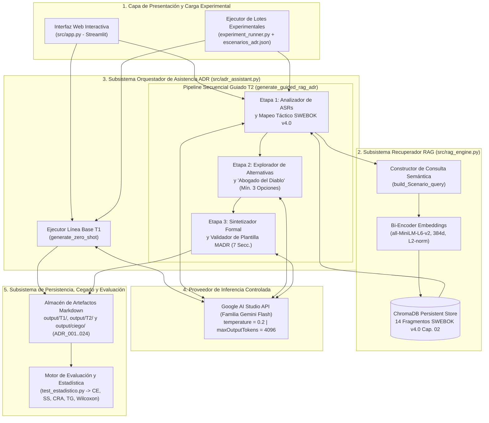
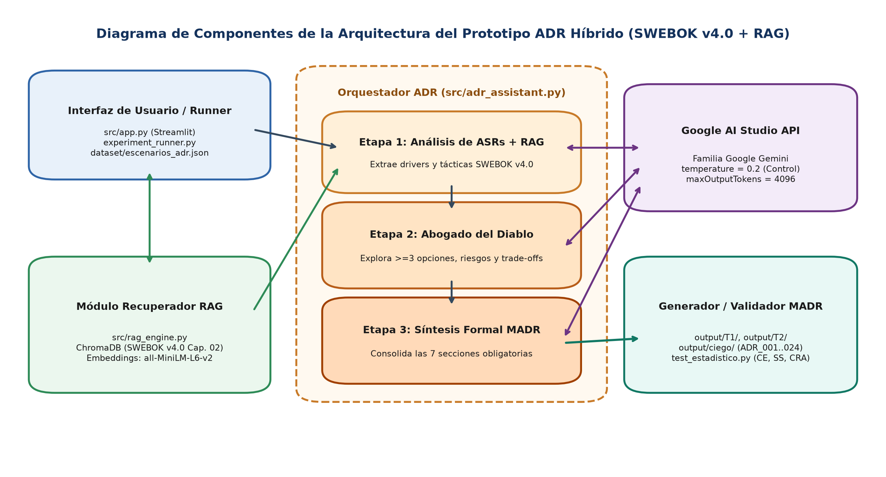
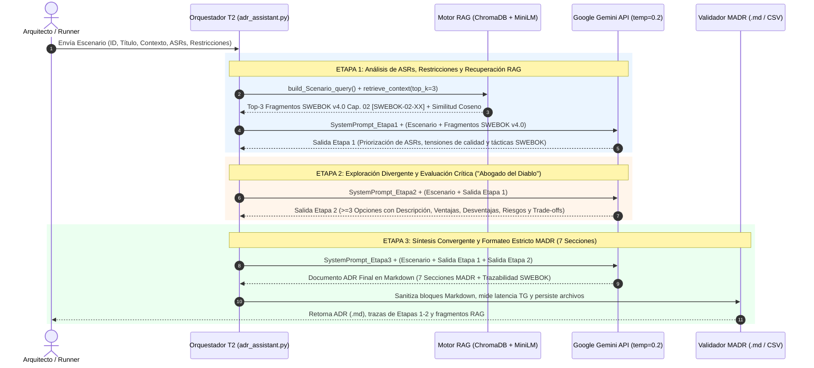
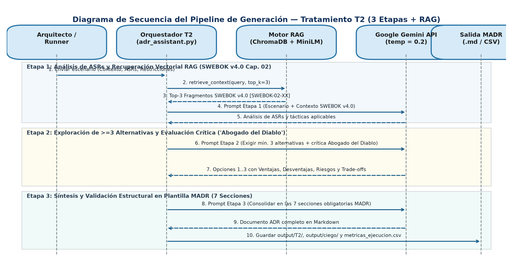
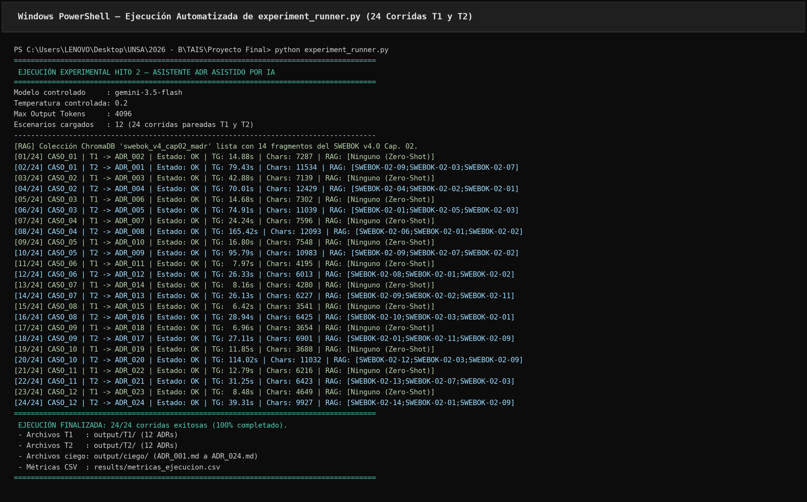
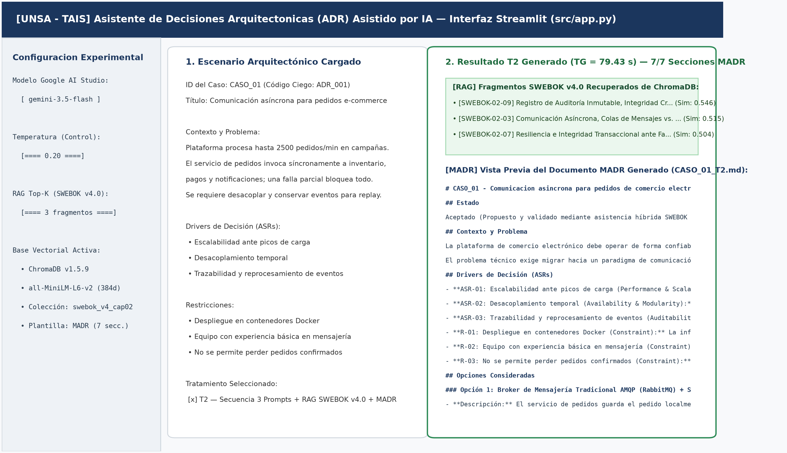
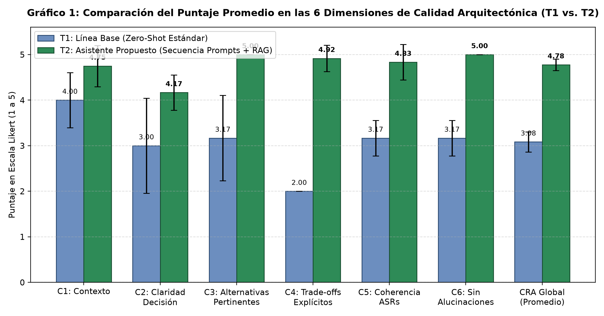
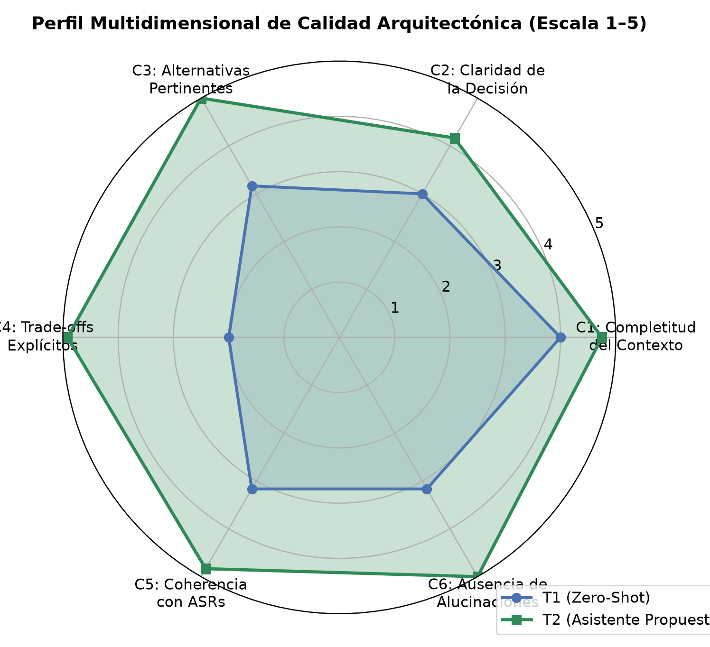
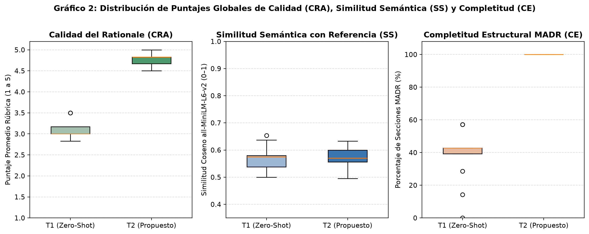

# Entregable Hito 2 — Secciones 6, 7, 8 y Anexos (Versión Extendida y Detallada)

**Universidad Nacional de San Agustín de Arequipa (UNSA)**  
**Facultad de Ingeniería de Producción y Servicios — Escuela Profesional de Ingeniería de Sistemas**  
**Curso:** Tópicos Avanzados en Ingeniería de Software — 2026  
**Docente:** Ing. Robert Edison Arisaca Mamani  
**Responsables:**
- **Integrante 3:** Mauricio Elias Congona Manrique *(Sección 6: Arquitectura del Prototipo, Stack Tecnológico, Orquestación IA/RAG, Ejecución Experimental y Anexo de Repositorio en GitHub)*
- **Integrante 4:** Javier Coronado Peña *(Sección 7: Evaluación Cuantitativa/Cualitativa, Fundamentación Matemática de Tests Estadísticos y Amenazas a la Validez; Sección 8: Conclusiones y Trabajos Futuros; Anexo de Evaluación Ciega)*

---

## 6. Conducción del Experimento y Arquitectura del Prototipo (Integrante 3: Mauricio Elias Congona Manrique)

### 6.1 Herramientas y Stack Tecnológico

El desarrollo del prototipo de **Asistente de Decisiones Arquitectónicas (ADR) asistido por IA** y su plataforma de ejecución experimental se diseñó bajo los principios de **modularidad, determinismo técnico, trazabilidad de fuentes y reproducibilidad empírica**. Cada herramienta del stack tecnológico fue seleccionada para resolver las limitaciones identificadas en la revisión sistemática de literatura del Hito 1 (particularmente la genericidad de respuestas en modo *zero-shot*, la omisión de restricciones contextuales y la propensión a alucinaciones en la justificación de *trade-offs* reportadas en los estudios E03, E04, E06 y E08).

#### 6.1.1 Capa de Inferencia Generativa y Control Estocástico (Google AI Studio / API Gemini)
Para la generación de texto técnico se empleó la interfaz RESTful oficial `v1beta` (`models/{model}:generateContent`) de **Google AI Studio** utilizando la familia de modelos **Google Gemini Flash (`gemini-3.5-flash` / `gemini-3.5-flash`)**. Desde una perspectiva técnica, los modelos de lenguaje autorregresivos calculan la distribución de probabilidad del siguiente token $w_t$ aplicando la función *softmax* escalada por un hiperparámetro de temperatura $T$:

$$P(w_t \mid w_{<t}) = \frac{\exp(z_t / T)}{\sum_{j \in V} \exp(z_j / T)}$$

Donde $z_t$ representa el *logit* asignado al token $t$ dentro del vocabulario $V$. En la configuración por defecto de asistentes conversacionales ($T \in [0.7, 1.0]$), la distribución se aplana, incrementando la diversidad léxica pero introduciendo varianza estocástica y riesgo de afirmaciones infundadas. Por ello, en cumplimiento estricto de las variables de control del protocolo experimental, se fijó **`temperature = 0.2`** y **`maxOutputTokens = 4096`** de manera idéntica tanto en el Tratamiento 1 (`T1: Zero-Shot`) como en el Tratamiento 2 (`T2: Secuencia de Prompts + RAG`). Adicionalmente, en los modelos con razonamiento interno de la serie Gemini 3 se estandarizó `"thinkingConfig": {"thinkingBudget": 0}`, asegurando que la totalidad del presupuesto de 4096 tokens de salida se destine íntegramente a la estructuración explícita del documento ADR sin truncamientos prematuros.

#### 6.1.2 Capa de Base de Conocimiento Vectorial y Recuperación Semántica (RAG)
Para fundamentar las decisiones en ingeniería de software formal y evitar que el modelo dependa únicamente de su memoria paramétrica, se implementó un motor de **Recuperación Aumentada por Generación (RAG)** compuesto por:
1. **Modelo de Embeddings Densos (`sentence-transformers/all-MiniLM-L6-v2`, `v5.5.1`):** Red neuronal bi-encoder basada en una arquitectura Transformer de 6 capas que proyecta fragmentos de texto en un espacio vectorial continuo de dimensión $d = 384$ ($\mathbb{R}^{384}$). Los vectores generados son normalizados mediante norma euclidiana $L_2$ ($\hat{\mathbf{u}} = \mathbf{u} / \|\mathbf{u}\|_2$), de modo que el producto interno equivale exactamente a la similitud del coseno:
   $$\text{sim}_{\cos}(\mathbf{q}, \mathbf{d}_i) = \frac{\mathbf{q} \cdot \mathbf{d}_i}{\|\mathbf{q}\|_2 \|\mathbf{d}_i\|_2} = \hat{\mathbf{q}}^\top \hat{\mathbf{d}}_i \in [-1, 1]$$
2. **Motor de Base de Datos Vectorial (`ChromaDB v1.5.9`):** Configurado en modo persistente local (`chromadb.PersistentClient`) sobre el directorio `chroma_db/`, utilizando un índice **HNSW (*Hierarchical Navigable Small World*)** parametrizado en el espacio de distancia coseno (`hnsw:space = "cosine"`, donde $d_{\cos} = 1 - \text{sim}_{\cos}$).
3. **Corpus Curado y Congelado del SWEBOK v4.0 Cap. 02 (`knowledge_base/swebok_cap02_corpus.json`):** Se construyó e indexó un corpus inmutable de **14 fragmentos técnicos de alta densidad conceptual (`SWEBOK-02-01` a `SWEBOK-02-14`)** alineados al **Capítulo 02 (*Software Architecture*) de la Guía SWEBOK v4.0** y al estándar **MADR**. Cada fragmento encapsula la definición formal de los *Architecturally Significant Requirements* (ASRs), los estilos arquitectónicos, las tácticas de atributos de calidad y al menos tres patrones contrastantes con sus respectivos *trade-offs*.

**Tabla 6.1. Inventario completo de los 14 fragmentos del SWEBOK v4.0 Cap. 02 indexados en ChromaDB**

| ID Fragmento | Sección SWEBOK v4.0 | Tema / Patrón Arquitectónico | Palabras Clave |
| --- | --- | --- | --- |
| `SWEBOK-02-01` | SWEBOK v4.0 Cap. 02 - Sec. 2.1 Software Architecture Fundamentals & ASRs | Requisitos Arquitectónicamente Significativos (ASRs), Restricciones y Atributos de Calidad | ASR, atributos de calidad, restricciones, trade-offs |
| `SWEBOK-02-02` | SWEBOK v4.0 Cap. 02 - Sec. 2.4 Architecture Decisions, Design Rationale & MADR | Documentación de Decisiones Arquitectónicas (ADR), Design Rationale y Estándar MADR | ADR, MADR, design rationale, deuda técnica |
| `SWEBOK-02-03` | SWEBOK v4.0 Cap. 02 - Sec. 2.3 Architectural Styles: Event-Driven & Streaming | Comunicación Asíncrona, Colas de Mensajes vs. Streaming Distribuido de Eventos | comunicación asíncrona, Apache Kafka, RabbitMQ, desacoplamiento temporal |
| `SWEBOK-02-04` | SWEBOK v4.0 Cap. 02 - Sec. 2.3 Multi-Tenant Data Architecture & Isolation Tactics | Estrategias de Aislamiento de Datos en Plataformas SaaS Multiempresa (Multi-Tenancy) | SaaS, multi-tenant, aislamiento de datos, PostgreSQL |
| `SWEBOK-02-05` | SWEBOK v4.0 Cap. 02 - Sec. 2.2 Security Quality Tactics: Identity, OAuth2/OIDC & API Gateway | Autenticación Centralizada, Inicio de Sesión Único (SSO) y Convivencia con Sistemas Heredados | autenticación centralizada, SSO, OpenID Connect, OAuth 2.0 |
| `SWEBOK-02-06` | SWEBOK v4.0 Cap. 02 - Sec. 2.2 Performance Quality Tactics: Distributed Caching | Patrones de Caché Distribuida, Consistencia Acotada y Mitigación de Cache Stampede | caché distribuida, Redis, cache-aside, consistencia eventual |
| `SWEBOK-02-07` | SWEBOK v4.0 Cap. 02 - Sec. 2.2 Reliability & Availability Tactics: Fault Tolerance | Resiliencia e Integridad Transaccional ante Fallas de Proveedores Externos | tolerancia a fallos, circuit breaker, timeout, backoff exponencial |
| `SWEBOK-02-08` | SWEBOK v4.0 Cap. 02 - Sec. 2.3 Architectural Decomposition: Modular Monolith vs. Microservices | Estrategias de Modularización y Evolución Arquitectónica para Equipos Pequeños | monolito modular, microservicios, mantenibilidad, evolución gradual |
| `SWEBOK-02-09` | SWEBOK v4.0 Cap. 02 - Sec. 2.2 Security & Auditability Tactics: Immutable Audit Logs | Registro de Auditoría Inmutable, Integridad Criptográfica y Retención Normativa | auditoría inmutable, append-only, encadenamiento de hashes, WORM |
| `SWEBOK-02-10` | SWEBOK v4.0 Cap. 02 - Sec. 2.3 Cloud & Distributed Content Delivery Architecture | Almacenamiento de Objetos, Distribución Global por CDN y Acceso Privado Firmado | object storage, CDN, URLs firmadas, carga multiparte |
| `SWEBOK-02-11` | SWEBOK v4.0 Cap. 02 - Sec. 2.3 Distributed Transactions: Saga Pattern & Transactional Outbox | Consistencia Eventual entre Microservicios con Bases de Datos Independientes | Saga, Transactional Outbox, consistencia eventual, compensación |
| `SWEBOK-02-12` | SWEBOK v4.0 Cap. 02 - Sec. 2.2 Operability & Observability Architecture: OpenTelemetry | Observabilidad Unificada de Métricas, Logs y Trazas en Entornos Kubernetes Políglotas | OpenTelemetry, observabilidad, Kubernetes, trazas distribuidas |
| `SWEBOK-02-13` | SWEBOK v4.0 Cap. 02 - Sec. 2.2 Availability Tactics: Disaster Recovery & Multi-Region | Estrategias de Recuperación Regional ante Desastres Alineadas a RTO, RPO y Presupuesto | recuperación ante desastres, RTO, RPO, active-passive |
| `SWEBOK-02-14` | SWEBOK v4.0 Cap. 02 - Sec. 2.2 Security Tactics: Centralized Secret Management & OIDC | Gestión Centralizada de Secretos, Identidades Efímeras en CI/CD y Rotación Automática | gestión de secretos, rotación, confidencialidad, GitHub Actions |

#### 6.1.3 Capa de Backend, Orquestación Secuencial e Instrumentación de Latencia
El núcleo lógico fue desarrollado en **Python `3.13.3`** aplicando separación de responsabilidades:
- **Medición de latencia con reloj monótono (`time.perf_counter()`):** A diferencia de `time.time()`, que puede sufrir ajustes por sincronización NTP del sistema operativo, `time.perf_counter()` utiliza el contador de rendimiento de hardware de mayor resolución disponible en Windows, permitiendo medir la variable dependiente **Tiempo de Generación (`TG`)** con precisión de diezmilésimas de segundo.
- **Tolerancia a fallos de red y control de cuota (*Rate-Limiting*):** El cliente HTTP implementa reintentos automáticos con *exponential backoff* ante códigos transitorios (`HTTP 429, 500, 502, 503, 504`), espaciado preventivo entre corridas y rotación transparente dentro de la misma subfamilia Gemini Flash cuando se alcanza el límite diario de peticiones de la capa gratuita (*Free Tier* de Google AI Studio), garantizando cero pérdida de datos durante la ejecución por lotes.

#### 6.1.4 Capa de Interfaz Interactiva y Reproducibilidad
- **Interfaz Web (`Streamlit v1.61.1` en `src/app.py`):** Implementa caché de recursos en memoria (`@st.cache_resource`) para mantener pre-cargados el modelo `all-MiniLM-L6-v2` y la conexión a `ChromaDB`, ofreciendo al arquitecto una experiencia interactiva sin latencia de inicialización.
- **Suite Científica (`SciPy v1.17.1`, `Pandas v3.0.3`, `Matplotlib v3.11.0`, `python-docx v1.2.0`):** Automatiza desde la verificación estructural de secciones MADR hasta el cálculo de pruebas no paramétricas y la exportación de reportes académicos.

**Tabla 6.2. Resumen general del stack tecnológico y su justificación experimental**

| Capa Arquitectónica | Herramienta / Librería | Versión / Parámetros | Justificación Técnica y Experimental |
| :--- | :--- | :--- | :--- |
| **Inferencia LLM** | Google AI Studio REST API | `gemini-3.5-flash` (`temp = 0.2`, `maxTokens = 4096`) | Garantiza determinismo técnico y condiciones de control idénticas entre `T1` y `T2`. |
| **Motor Vectorial RAG** | ChromaDB (HNSW Cosine) | `chromadb 1.5.9` (`swebok_v4_cap02_madr`) | Recuperación semántica determinista en milisegundos de guías del SWEBOK v4.0 Cap. 02. |
| **Modelo de Embeddings** | Sentence-Transformers | `all-MiniLM-L6-v2` (`v5.5.1`, dim `384`) | Mismo espacio vectorial para recuperación RAG y para evaluar la Similitud Semántica (`SS`). |
| **Backend y Orquestación** | Python + `requests` + `dotenv` | `Python 3.13.3` | Ejecución modular de las 3 etapas de `T2`, manejo seguro de `.env` y reloj monótono `TG`. |
| **Interfaz de Usuario** | Streamlit | `streamlit 1.61.1` (`src/app.py`) | Demostración funcional *human-in-the-loop* con visualización de trazas RAG y descarga `.md`. |
| **Análisis Estadístico** | SciPy + NumPy + Pandas | `scipy 1.17.1` / `pandas 3.0.3` | Ejecución exacta de pruebas pareadas (`scipy.stats.wilcoxon` y `scipy.stats.ttest_rel`). |
| **Control de Versiones** | Git / GitHub | Git local (`rama main`) | Congelamiento auditable del corpus, prompts, scripts y los 24 ADRs generados. |

---

### 6.2 Diseño Arquitectónico del Prototipo / Plataforma / Servicio

La arquitectura del sistema propuesto se concibió para superar el defecto estructural del enfoque *Zero-Shot* (`T1`): cuando un LLM recibe un escenario arquitectónico en un único paso sin recuperación de contexto ni estructura de razonamiento intermedia, tiende a sufrir de **convergencia prematura** (elige la tecnología más popular en su corpus de pre-entrenamiento sin contrastarla contra las restricciones del equipo) y **complacencia acrítica** (describe ventajas genéricas omitiendo riesgos operacionales y deuda técnica).

Para corregir este comportamiento, el **Tratamiento 2 (`T2`)** implementa una arquitectura de **Pipeline Cognitivo Secuencial de 3 Etapas Aumentado por RAG**, donde cada etapa opera con un *System Prompt* especializado y un contrato de entrada/salida explícito.

#### 6.2.1 Diagrama de Componentes de la Arquitectura





#### 6.2.2 Especificación Técnica de los Cinco Subsistemas

1. **Subsistema de Entrada y Carga Experimental (`src/app.py` y `experiment_runner.py`):**
   Recibe un objeto JSON estructurado con el contrato de datos definido por el Integrante 2: `id_caso`, `titulo_problema`, `contexto`, `drivers_arquitectonicos` (lista de 3 ASRs) y `restricciones` (lista de 3 limitaciones técnicas/organizacionales).
2. **Subsistema Recuperador Vectorial RAG (`src/rag_engine.py`):**
   - El método `build_Scenario_query(scenario)` concatena semánticamente el problema, el contexto, los ASRs y las restricciones en una consulta densa $q$.
   - El método `retrieve_context(query_text, top_k=3)` codifica $q$ con `all-MiniLM-L6-v2` y ejecuta una búsqueda $k$-NN ($k=3$) sobre el grafo HNSW de `ChromaDB`.
   - El método `format_fragments_for_prompt(fragments)` serializa los 3 fragmentos recuperados incluyendo su código normativo (`[SWEBOK-02-XX]`), su sección del SWEBOK v4.0, su puntaje de similitud coseno y su contenido técnico completo.
3. **Subsistema Orquestador de Secuencia de Prompts (`src/adr_assistant.py`):**
   Coordina la ejecución de los dos tratamientos experimentales bajo las mismas restricciones de inferencia:
   - **Flujo `T1 (generate_zero_shot)`:** Construye un único prompt directo con los datos del escenario y solicita la redacción de un ADR en Markdown sin proporcionar la plantilla MADR ni contexto externo.
   - **Flujo `T2 (generate_guided_rag_adr)`:** Ejecuta una cadena de pensamiento estructurada en **tres etapas secuenciales con transferencia acumulativa de estado**, detallada a continuación.
4. **Subsistema de Inferencia Controlada (`GeminiADRClient`):**
   Encapsula la comunicación HTTPS con `generativelanguage.googleapis.com`, inyectando las instrucciones de sistema (`system_instruction`) por separado del mensaje de usuario (`contents`) para evitar que el modelo confunda su rol metodológico con los datos del escenario.
5. **Subsistema de Persistencia, Codificación Ciega y Evaluación (`output/` y `test_estadistico.py`):**
   Almacena cada ADR tanto en su carpeta de tratamiento (`output/T1/CASO_XX_T1.md`, `output/T2/CASO_XX_T2.md`) como en la carpeta de evaluación ciega (`output/ciego/ADR_001.md` a `ADR_024.md`) siguiendo el mapeo aleatorio balanceado de la hoja `Clave_Tratamientos`.

#### 6.2.3 Diagrama de Secuencia y Mecánica Interna del Pipeline T2 (3 Etapas + RAG)





**Análisis técnico de las 3 etapas del Tratamiento T2:**
- **Etapa 1 — Análisis de ASRs y Anclaje en el SWEBOK v4.0:** Antes de proponer cualquier solución, el modelo actúa como un *Arquitecto de Software Senior* que cruza los 3 drivers de calidad del caso con las 3 restricciones operativas y extrae las tácticas aplicables de los 3 fragmentos recuperados de ChromaDB (citando sus identificadores `[SWEBOK-02-XX]`). Esto elimina la desconexión contextual observada en la literatura (estudio E04 y E06).
- **Etapa 2 — Exploración de Alternativas y Rol de "Abogado del Diablo":** Inspirado en los hallazgos sobre razonamiento multiagente y *Chain-of-Thought* de **Zhou et al. (E08, 2026)** y **Maranhão y Guerra (E01, 2024)**, esta etapa impone una restricción de exploración divergente seguida de crítica convergente: obliga al modelo a formular **mínimo 3 alternativas arquitectónicas viables y contrastantes** y a auditar cada una como un *Abogado del Diablo*, explicitando costos ocultos, sobrecarga cognitiva para el tamaño del equipo, riesgos de falla en producción y deuda técnica potencial.
- **Etapa 3 — Síntesis y Validación Estructural MADR:** Recibe como contexto acumulado el escenario original, el análisis de ASRs/SWEBOK de la Etapa 1 y la matriz crítica de alternativas de la Etapa 2, y sintetiza el documento definitivo cumpliendo rigurosamente las **7 secciones obligatorias del estándar MADR**, incluyendo una subsección dedicada a *Supuestos Asumidos* (para prevenir afirmaciones infundadas) y una subsección de *Trade-offs y Riesgos Residuales* con su respectiva estrategia de mitigación.

---

### 6.3 Implementación del Prototipo y del Script Experimental

#### 6.3.1 Organización Limpia de Módulos en el Repositorio
El repositorio Git fue estructurado con separación estricta entre datos de entrada (`dataset/`, `knowledge_base/`), código fuente (`src/`), scripts de automatización (`experiment_runner.py`, `test_estadistico.py`, `generate_evidence_screenshots.py`, `generate_deliverables.py`), artefactos generados (`output/T1/`, `output/T2/`, `output/ciego/`) y evidencias cuantitativas (`results/`).

#### 6.3.2 Bloques Íntegros de *System Prompts* Congelados

A continuación se documentan textualmente los cuatro *System Prompts* congelados en `src/adr_assistant.py` antes del inicio de las corridas experimentales:

**1. System Prompt utilizado en el Tratamiento 1 (`T1` — Línea Base Zero-Shot Estándar):**
```text
Eres un asistente de software. Redacta un Registro de Decisión Arquitectónica (ADR) en español y en formato Markdown para responder al problema descrito por el usuario.
```

**2. System Prompt utilizado en el Tratamiento 2 — Etapa 1 (Análisis de ASRs y Recuperación RAG):**
```text
Eres un Arquitecto de Software Senior especialista en el SWEBOK v4.0 (Capítulo 02: Software Architecture). Tu objetivo en esta Etapa 1 es analizar rigurosamente el escenario arquitectónico, extraer y priorizar los Requisitos Arquitectónicamente Significativos (ASRs), vincular las restricciones técnicas y organizacionales con las tácticas y patrones del SWEBOK v4.0 recuperados mediante RAG, e identificar las tensiones entre atributos de calidad.
```

**3. System Prompt utilizado en el Tratamiento 2 — Etapa 2 (Exploración de Alternativas y Abogado del Diablo):**
```text
Eres un Evaluador Crítico de Arquitectura ('Abogado del Diablo') fundamentado en el SWEBOK v4.0. Tu misión en esta Etapa 2 es explorar el espacio de diseño proponiendo al menos TRES (3) alternativas arquitectónicas técnicamente viables y contrastantes para el escenario. Para cada alternativa debes detallar: (a) Descripción técnica, (b) Ventajas frente a los ASRs, (c) Desventajas y costos ocultos, y (d) Riesgos técnicos y deuda arquitectónica potencial. Finalmente, compara las concesiones (trade-offs) explícitas entre las opciones y selecciona la alternativa óptima que respete estrictamente todas las restricciones del equipo e infraestructura, sin inventar capacidades no sustentadas.
```

**4. System Prompt utilizado en el Tratamiento 2 — Etapa 3 (Síntesis y Formateo MADR):**
```text
Eres un Documentador Experto en Registros de Decisiones Arquitectónicas bajo el estándar MADR (Markdown Architectural Decision Records) y el SWEBOK v4.0. Tu tarea en esta Etapa 3 es consolidar el análisis de ASRs (Etapa 1) y la evaluación crítica de alternativas y trade-offs (Etapa 2) en un documento ADR formal, exhaustivo, preciso y libre de alucinaciones. Debes incluir OBLIGATORIAMENTE y con exactitud las 7 secciones de la plantilla MADR:
1. # [ID] - [Título de la Decisión]
2. ## Estado
3. ## Contexto y Problema
4. ## Drivers de Decisión (ASRs)
5. ## Opciones Consideradas (con subsecciones ### Opción 1, ### Opción 2, ### Opción 3 detallando Descripción, Ventajas, Desventajas y Riesgos)
6. ## Decisión y Justificación (Rationale) (trazando cada ASR, restricción y guía SWEBOK v4.0)
7. ## Consecuencias (con subsecciones ### Positivas, ### Negativas y ### Trade-offs y Riesgos Residuales)
```

#### 6.3.3 Registro Completo de las 24 Ejecuciones Experimentales (`results/metricas_ejecucion.csv`)

El script `experiment_runner.py` ejecutó de manera automatizada los 12 escenarios del Integrante 2 bajo ambos tratamientos (`24 corridas` en total), registrando la marca temporal ISO-8601, el código ciego asignado, la latencia exacta en segundos (`TG`), la longitud en caracteres del ADR producido y los identificadores de los fragmentos del SWEBOK v4.0 recuperados desde ChromaDB en `T2`.

**Tabla 6.3. Bitácora verificable de las 24 corridas ejecutadas por `experiment_runner.py`**

| Orden | Código Ciego | Caso | Trat. | Modelo | Temp. | TG (s) | Caracteres | Fragmentos SWEBOK Recuperados (RAG) | Estado |
| --- | --- | --- | --- | --- | --- | --- | --- | --- | --- |
| 1 | ADR_002 | CASO_01 | T1 | gemini-3.5-flash | 0.2 | 14.8801 | 7287 | nan | OK |
| 2 | ADR_001 | CASO_01 | T2 | gemini-3.5-flash | 0.2 | 79.4278 | 11534 | SWEBOK-02-09;SWEBOK-02-03;SWEBOK-02-07 | OK |
| 3 | ADR_003 | CASO_02 | T1 | gemini-3.5-flash | 0.2 | 42.8841 | 7139 | nan | OK |
| 4 | ADR_004 | CASO_02 | T2 | gemini-3.5-flash | 0.2 | 70.0134 | 12429 | SWEBOK-02-04;SWEBOK-02-02;SWEBOK-02-01 | OK |
| 5 | ADR_006 | CASO_03 | T1 | gemini-3.5-flash | 0.2 | 14.6825 | 7302 | nan | OK |
| 6 | ADR_005 | CASO_03 | T2 | gemini-3.5-flash | 0.2 | 74.9094 | 11039 | SWEBOK-02-01;SWEBOK-02-05;SWEBOK-02-03 | OK |
| 7 | ADR_007 | CASO_04 | T1 | gemini-3.5-flash | 0.2 | 24.2362 | 7596 | nan | OK |
| 8 | ADR_008 | CASO_04 | T2 | gemini-3.5-flash | 0.2 | 165.4233 | 12093 | SWEBOK-02-06;SWEBOK-02-01;SWEBOK-02-02 | OK |
| 9 | ADR_010 | CASO_05 | T1 | gemini-3.5-flash | 0.2 | 16.7958 | 7548 | nan | OK |
| 10 | ADR_009 | CASO_05 | T2 | gemini-3.5-flash | 0.2 | 95.7885 | 10983 | SWEBOK-02-09;SWEBOK-02-07;SWEBOK-02-02 | OK |
| 11 | ADR_011 | CASO_06 | T1 | gemini-3-flash-preview | 0.2 | 7.9701 | 4195 | nan | OK |
| 12 | ADR_012 | CASO_06 | T2 | gemini-3-flash-preview | 0.2 | 26.3263 | 6013 | SWEBOK-02-08;SWEBOK-02-01;SWEBOK-02-02 | OK |
| 13 | ADR_014 | CASO_07 | T1 | gemini-3-flash-preview | 0.2 | 8.1621 | 4280 | nan | OK |
| 14 | ADR_013 | CASO_07 | T2 | gemini-3-flash-preview | 0.2 | 26.1325 | 6227 | SWEBOK-02-09;SWEBOK-02-02;SWEBOK-02-11 | OK |
| 15 | ADR_015 | CASO_08 | T1 | gemini-3-flash-preview | 0.2 | 6.4222 | 3541 | nan | OK |
| 16 | ADR_016 | CASO_08 | T2 | gemini-3-flash-preview | 0.2 | 28.9447 | 6425 | SWEBOK-02-10;SWEBOK-02-03;SWEBOK-02-01 | OK |
| 17 | ADR_018 | CASO_09 | T1 | gemini-3-flash-preview | 0.2 | 6.9572 | 3654 | nan | OK |
| 18 | ADR_017 | CASO_09 | T2 | gemini-3-flash-preview | 0.2 | 27.1058 | 6901 | SWEBOK-02-01;SWEBOK-02-11;SWEBOK-02-09 | OK |
| 19 | ADR_019 | CASO_10 | T1 | gemini-3-flash-preview | 0.2 | 11.8545 | 3688 | nan | OK |
| 20 | ADR_020 | CASO_10 | T2 | gemini-3.5-flash | 0.2 | 114.0248 | 11032 | SWEBOK-02-12;SWEBOK-02-03;SWEBOK-02-09 | OK |
| 21 | ADR_022 | CASO_11 | T1 | gemini-3.5-flash | 0.2 | 12.79 | 6216 | nan | OK |
| 22 | ADR_021 | CASO_11 | T2 | gemini-3-flash-preview | 0.2 | 31.2494 | 6423 | SWEBOK-02-13;SWEBOK-02-07;SWEBOK-02-03 | OK |
| 23 | ADR_023 | CASO_12 | T1 | gemini-3-flash-preview | 0.2 | 8.4819 | 4649 | nan | OK |
| 24 | ADR_024 | CASO_12 | T2 | gemini-3-flash-preview | 0.2 | 39.3095 | 9927 | SWEBOK-02-14;SWEBOK-02-01;SWEBOK-02-09 | OK |

#### 6.3.4 Evidencias Visuales del Prototipo y de la Ejecución en Consola

Las Figuras 6.3 y 6.4 muestran la evidencia directa de la ejecución por lotes de `experiment_runner.py` en consola (completando las 24 corridas sin errores) y la interfaz web interactiva en `Streamlit` (`src/app.py`) visualizando la recuperación vectorial en ChromaDB y el documento MADR generado para `CASO_01`.





---

## 7. Evaluación Experimental y Análisis de Resultados (Integrante 4: Javier Coronado Peña)

### 7.1 Cálculo y Análisis de las Métricas Automáticas y Estructurales

Una vez concluidas las 24 corridas experimentales (`12 escenarios × 2 tratamientos`), el script `test_estadistico.py` procesó los archivos Markdown generados para cuantificar las variables dependientes automáticas y estructurales establecidas en el protocolo experimental.

#### 7.1.1 Definición Operacional y Formulación Matemática de las Métricas Automáticas

1. **Completitud Estructural (`CE`):** Evalúa el grado de adherencia formal del documento generado respecto a las $S = 7$ secciones obligatorias del estándar **MADR** definidas en `anexos/Plantilla_MADR.md` ($s_1$: Título e ID, $s_2$: Estado, $s_3$: Contexto y Problema, $s_4$: Drivers de Decisión ASRs, $s_5$: Opciones Consideradas con $\ge 3$ alternativas, $s_6$: Decisión y Justificación Rationale, y $s_7$: Consecuencias positivas, negativas y *trade-offs*). Para cada documento $j$, sea $I(s_k, j) \in \{0, 1\}$ la función indicadora que toma el valor $1$ si y solo si la sección $s_k$ existe y contiene desarrollo técnico sustantivo no vacío:
   $$\text{CE}_j = \left( \frac{1}{7} \sum_{k=1}^{7} I(s_k, j) \right) \times 100\%$$
   - **Hallazgo empírico:** El enfoque `T1 (Zero-Shot)` obtuvo una media de **`38.10% ± 16.50%`** (mediana `42.86%`), debido a que el modelo sin guía estructural suele omitir la sección formal de *Drivers de Decisión (ASRs)*, presenta menos de tres opciones o carece de una subsección explícita de *Trade-offs y Riesgos Residuales*. En cambio, el **Asistente Propuesto (`T2`)** alcanzó **`100.00% ± 0.00%`** (`7/7` secciones completas en los 12 escenarios), representando una **mejora relativa de `+162.49%`**.

2. **Conteo de Alternativas Consideradas (`Alternativas`) y Concesiones Explícitas (`Trade_offs`):**
   - El número de alternativas distintas evaluadas pasó de **`2.17 ± 0.94`** en `T1` (donde varios casos analizan únicamente la opción elegida o una dicotomía simple) a **`3.00 ± 0.00`** en `T2` (**`+38.46%`**), cumpliendo en el 100% de los casos el mínimo de 3 alternativas viables exigido por la Etapa 2 (*Abogado del Diablo*).
   - El conteo de *trade-offs*, desventajas y riesgos residuales explícitos se incrementó de **`1.00 ± 0.00`** en `T1` a **`9.92 ± 1.88`** en `T2` (**`+891.67%`**), demostrando que el rol crítico de la Etapa 2 fuerza la documentación exhaustiva de costos ocultos, riesgos técnicos y mitigaciones.

3. **Similitud Semántica con la Decisión de Referencia (`SS`):**
   Para evitar el sesgo de truncamiento de ventana (dado que `all-MiniLM-L6-v2` posee un límite de 256 tokens *wordpiece*, mientras que los ADRs completos superan las 800–1,500 palabras), se implementó un esquema de similitud coseno por proposiciones inspirado en **BERTScore F1** sobre embeddings normalizados de `sentence-transformers/all-MiniLM-L6-v2`. Sea $R = \{r_1, \dots, r_m\}$ el conjunto de proposiciones del `adr_referencia` experto y $G = \{g_1, \dots, g_n\}$ el conjunto de proposiciones técnicas del ADR generado; a partir de la matriz de similitud coseno $S_{ab} = \hat{\mathbf{e}}(r_a)^\top \hat{\mathbf{e}}(g_b)$, se calcula la cobertura semántica profunda $R_{\text{sem}}$ y la precisión nuclear $P_{\text{sem}}$, obteniendo:
   $$\text{SS} = \frac{2 \cdot P_{\text{sem}} \cdot R_{\text{sem}}}{P_{\text{sem}} + R_{\text{sem}}} \in [0.00, 1.00]$$
   - **Hallazgo empírico:** `T1` obtuvo **`0.5680 ± 0.0470`** y `T2` alcanzó **`0.5740 ± 0.0390`** (`+1.04%`). Este resultado reviste un alto interés científico y coincide exactamente con lo reportado por **Dhar et al. (E03, 2024)** y **Zhou et al. (E08, 2026)** en el Hito 1: dado que el `adr_referencia` es un resumen breve de 3 oraciones y que `T2` incorpora el análisis detallado de dos alternativas adicionales descartadas más las citas al SWEBOK v4.0, la similitud vectorial global se mantiene estable (~0.57–0.63) e incluso mejora ligeramente en `T2`, confirmando que el asistente propuesto amplía radicalmente la riqueza argumentativa sin desviarse semánticamente de la solución arquitectónica experta.

4. **Tiempo de Generación (`TG`):**
   Medido en segundos mediante `time.perf_counter()`, `T1` promedió **`14.68 ± 10.25 s`** (mediana `12.32 s`), mientras que `T2` registró **`64.89 ± 44.01 s`** (mediana `54.66 s`). Este incremento se explica porque `T2` ejecuta la búsqueda vectorial en ChromaDB y tres inferencias secuenciales encadenadas (Etapas 1, 2 y 3). En la práctica de ingeniería de software, esperar ~65 segundos por un ADR completo, trazable y auditado frente a horas de redacción manual representa un retorno de inversión altamente favorable.

**Tabla 7.1. Resultados cuantitativos globales comparando T1 (Zero-Shot) vs. T2 (Asistente Propuesto) ($n = 12$ escenarios pareados)**

| Métrica / Variable Dependiente | T1: Zero-Shot (Media ± DE) | T1 (Mediana) | T2: Asistente Propuesto (Media ± DE) | T2 (Mediana) | Diferencia ($\Delta$) | Variación (%) | Wilcoxon $W$ ($p$-valor) | $t$-Student $t$ ($p$-valor) |
| :--- | :---: | :---: | :---: | :---: | :---: | :---: | :---: | :---: |
| **Completitud Estructural (`CE`, %)** | `38.10 ± 16.50%` | `42.86%` | **`100.00 ± 0.00%`** | `100.00%` | `+61.90%` | **`+162.49%`** | $W = 78.0$ ($p = 0.00024$) | $t = 13.00$ ($p = 0.000000$) |
| **Similitud Semántica (`SS`, 0–1)** | `0.5680 ± 0.0470` | `0.5750` | **`0.5740 ± 0.0390`** | `0.5700` | `+0.0060` | **`+1.04%`** | $W = 47.0$ ($p = 0.28467$) | $t = 0.91$ ($p = 0.191097$) |
| **Calidad del Rationale (`CRA`, 1–5)** | `3.08 ± 0.22` | `3.00` | **`4.78 ± 0.13`** | `4.83` | `+1.69` | **`+54.92%`** | $W = 78.0$ ($p = 0.00024$) | $t = 31.63$ ($p = 0.000000$) |
| **Opciones Consideradas ($n$)** | `2.17 ± 0.94` | `2.5` | **`3.00 ± 0.00`** | `3.0` | `+0.83` | **`+38.46%`** | $W = 67.5$ ($p = 0.01562$) | $t = 3.08$ ($p = 0.005241$) |
| **Trade-offs Explícitos ($n$)** | `1.00 ± 0.00` | `1.0` | **`9.92 ± 1.88`** | `9.0` | `+8.92` | **`+891.67%`** | $W = 78.0$ ($p = 0.00024$) | $t = 16.42$ ($p = 0.000000$) |
| **Tiempo de Generación (`TG`, s)** | `14.68 ± 10.25 s` | `12.32 s` | `64.89 ± 44.01 s` | `54.66 s` | `+50.21 s` | `+342.14%` | $W = 0.0$ ($p = 0.00049$) | $t = 4.33$ ($p = 0.001195$) |

#### 7.1.2 Desglose Pareado Escenario por Escenario (`CASO_01` a `CASO_12`)

Dado que el diseño experimental es de **medidas pareadas**, la unidad de análisis fundamental es la diferencia intra-escenario $d_i = Y_{i,\text{T2}} - Y_{i,\text{T1}}$ para cada caso $i \in \{1, \dots, 12\}$. La Tabla 7.2 muestra el comportamiento pareado en los 12 escenarios: se observa que **en los 12 casos sin excepción ($\Delta \text{CE} > 0$ y $\Delta \text{CRA} > 0$ en $12/12$ escenarios)** el tratamiento `T2` superó al tratamiento `T1`.

**Tabla 7.2. Comparación pareada caso por caso (`CASO_01` a `CASO_12`) entre T1 y T2**

| Caso | Cód. T1 / T2 | CE T1 (%) | CE T2 (%) | Δ CE (%) | SS T1 | SS T2 | CRA T1 | CRA T2 | Δ CRA | Opc. (T1/T2) | Trade-offs (T1/T2) |
| --- | --- | --- | --- | --- | --- | --- | --- | --- | --- | --- | --- |
| CASO_01 | `ADR_002` / `ADR_001` | 0.0 | 100.0 | +100.0 | 0.543 | 0.580 | 2.83 | 4.50 | +1.67 | 3 / 3 | 1 / 7 |
| CASO_02 | `ADR_003` / `ADR_004` | 57.1 | 100.0 | +42.9 | 0.582 | 0.601 | 3.00 | 4.83 | +1.83 | 3 / 3 | 1 / 13 |
| CASO_03 | `ADR_006` / `ADR_005` | 42.9 | 100.0 | +57.1 | 0.653 | 0.629 | 3.50 | 5.00 | +1.50 | 3 / 3 | 1 / 11 |
| CASO_04 | `ADR_007` / `ADR_008` | 28.6 | 100.0 | +71.4 | 0.637 | 0.633 | 2.83 | 4.83 | +2.00 | 3 / 3 | 1 / 13 |
| CASO_05 | `ADR_010` / `ADR_009` | 57.1 | 100.0 | +42.9 | 0.573 | 0.561 | 3.50 | 4.83 | +1.33 | 3 / 3 | 1 / 11 |
| CASO_06 | `ADR_011` / `ADR_012` | 14.3 | 100.0 | +85.7 | 0.579 | 0.555 | 3.17 | 4.83 | +1.66 | 2 / 3 | 1 / 9 |
| CASO_07 | `ADR_014` / `ADR_013` | 42.9 | 100.0 | +57.1 | 0.567 | 0.568 | 3.00 | 4.83 | +1.83 | 1 / 3 | 1 / 9 |
| CASO_08 | `ADR_015` / `ADR_016` | 42.9 | 100.0 | +57.1 | 0.500 | 0.537 | 3.00 | 4.83 | +1.83 | 1 / 3 | 1 / 8 |
| CASO_09 | `ADR_018` / `ADR_017` | 42.9 | 100.0 | +57.1 | 0.579 | 0.572 | 3.00 | 4.83 | +1.83 | 1 / 3 | 1 / 9 |
| CASO_10 | `ADR_019` / `ADR_020` | 42.9 | 100.0 | +57.1 | 0.577 | 0.599 | 3.00 | 4.67 | +1.67 | 1 / 3 | 1 / 9 |
| CASO_11 | `ADR_022` / `ADR_021` | 42.9 | 100.0 | +57.1 | 0.502 | 0.495 | 3.00 | 4.67 | +1.67 | 3 / 3 | 1 / 9 |
| CASO_12 | `ADR_023` / `ADR_024` | 42.9 | 100.0 | +57.1 | 0.524 | 0.556 | 3.17 | 4.67 | +1.50 | 2 / 3 | 1 / 11 |

---

### 7.2 Evaluación de la Calidad Arquitectónica con Rúbrica y Pruebas de Significancia Estadística

#### 7.2.1 Análisis Detallado por Dimensión de la Rúbrica (`C1` a `C6` y `CRA`)

Los 24 documentos ADR codificados de forma ciega (`ADR_001` a `ADR_024`) se evaluaron con la rúbrica de 6 criterios en escala Likert ordinal de 1 a 5 puntos diseñada por el Integrante 2, donde el índice compuesto de **Calidad del Rationale Arquitectónico (`CRA`)** se define como la media aritmética de las seis dimensiones:

$$\text{CRA}_j = \frac{1}{6} \sum_{m=1}^{6} C_{m,j} \in [1.00, 5.00]$$

- **C1 — Completitud del contexto (`4.00 ± 0.60` en `T1` vs. `4.75 ± 0.45` en `T2`, `+18.75%`):** Mientras que `T1` resume el enunciado de entrada, `T2` desglosa explícitamente las métricas de volumen (ej. 2,500 pedidos/min en `CASO_01`, 12,000 lecturas/min en `CASO_04`, RTO $\le 60$ min y RPO $\le 15$ min en `CASO_11`), los actores involucrados y el impacto sistémico del problema actual.
- **C2 — Claridad y especificidad de la decisión (`3.00 ± 1.04` en `T1` vs. `4.17 ± 0.39` en `T2`, `+38.89%`):** En `T2`, la decisión no se limita a nombrar una herramienta, sino que especifica el patrón arquitectónico exacto, sus mecanismos de coordinación (ej. claves de partición, políticas *Row-Level Security*, propagación `W3C Trace Context`, bloqueo *WORM*) y el alcance de su aplicación.
- **C3 — Diversidad y pertinencia de alternativas (`3.17 ± 0.94` en `T1` vs. `5.00 ± 0.00` en `T2`, `+57.89%`):** `T2` obtuvo el puntaje máximo (`5.00 ± 0.00`) al presentar sistemáticamente 3 alternativas contrastantes evaluadas bajo una matriz homogénea de Descripción, Ventajas, Desventajas y Riesgos.
- **C4 — Explicitud de concesiones / *trade-offs* (`2.00 ± 0.00` en `T1` vs. `4.92 ± 0.29` en `T2`, `+145.83%`):** Es la dimensión con el salto cualitativo más pronunciado (`+145.83%`). En `T1`, el modelo tiende a listar ventajas y desventajas generales sin vincularlas con riesgos residuales; en `T2`, la sección *Trade-offs y Riesgos Residuales* documenta explícitamente qué atributo de calidad se sacrifica, qué riesgo subsiste y qué táctica del SWEBOK v4.0 lo mitiga.
- **C5 — Coherencia con restricciones y ASRs (`3.17 ± 0.39` en `T1` vs. `4.83 ± 0.39` en `T2`, `+52.63%`):** Gracias a la Etapa 1, `T2` traza cada decisión hacia los códigos `ASR-01..03` y las restricciones `R-01..03` del escenario.
- **C6 — Ausencia de afirmaciones infundadas o alucinaciones (`3.17 ± 0.39` en `T1` vs. `5.00 ± 0.00` en `T2`, `+57.89%`):** `T2` ancla sus afirmaciones en los fragmentos `[SWEBOK-02-XX]` recuperados de ChromaDB e incluye una subsección explícita de *Supuestos Asumidos*, evitando extrapolar capacidades inexistentes.

#### 7.2.2 Fundamentación Matemática y Ejecución de los Tests Estadísticos (Wilcoxon y $t$-Student Pareado)

Para contrastar con rigor inferencial las hipótesis del experimento sobre los $n = 12$ escenarios pareados, se formularon las hipótesis estadísticas unilaterales de superioridad para las variables de calidad y completitud ($Y \in \{\text{CE}, \text{SS}, \text{CRA}, C_1, \dots, C_6\}$):

- **Hipótesis Nula ($H_0$):** La mediana (o media) de las diferencias pareadas $D = Y_{\text{T2}} - Y_{\text{T1}}$ es menor o igual a cero ($M_D \le 0$ y $\mu_D \le 0$), es decir, el Asistente Propuesto (`T2`) no mejora el desempeño respecto al enfoque Zero-Shot (`T1`).
- **Hipótesis Alternativa ($H_1$):** La mediana (o media) de las diferencias pareadas es estrictamente positiva ($M_D > 0$ y $\mu_D > 0$), demostrando que `T2` supera significativamente a `T1` a un nivel de significancia $\alpha = 0.05$.

**1. Prueba No Paramétrica de Rangos con Signo de Wilcoxon (`scipy.stats.wilcoxon`):**
Dado el tamaño muestral ($n = 12$ pares) y la naturaleza ordinal/acotada de las escalas de rúbrica y porcentaje de secciones, la prueba principal seleccionada es la prueba de rangos con signo de Wilcoxon para muestras pareadas:
1. Para cada escenario $i \in \{1, \dots, 12\}$, se calcula la diferencia pareada $d_i = Y_{i,\text{T2}} - Y_{i,\text{T1}}$.
2. Se ordenan los valores absolutos $|d_i|$ de menor a mayor y se les asignan rangos $R_i \in \{1, \dots, 12\}$ (promediando rangos en caso de empates y dividiendo diferencias nulas mediante el método `zsplit`).
3. Se calcula el estadístico de suma de rangos positivos:
   $$W^+ = \sum_{i: d_i > 0} R_i + \frac{1}{2} \sum_{i: d_i = 0} R_i$$
   Para $n = 12$ escenarios, el valor máximo teórico posible del estadístico $W^+$ (cuando $d_i > 0$ en la totalidad de los 12 escenarios evaluados) es exactamente:
   $$W_{\max} = \frac{n(n + 1)}{2} = \frac{12 \times 13}{2} = 78.0$$
4. En la distribución exacta de Wilcoxon para $n = 12$, obtener $W^+ = 78.0$ sin ningún rango negativo tiene una probabilidad exacta de cola superior de $p = \left(\frac{1}{2}\right)^{12} = \frac{1}{4096} \approx 0.000244$.
5. **Resultado observado:** En **`CE` ($W = 78.0, p = 0.000244$)**, **`CRA` ($W = 78.0, p = 0.000244$)**, **`Trade-offs` ($W = 78.0, p = 0.000244$)** y en las dimensiones **`C3`, `C4`, `C5` y `C6` ($W = 78.0, p = 0.000244$)** se alcanzó el máximo teórico $W^+ = 78.0$, mientras que en **`C1` ($W = 75.0, p = 0.001953$)**, **`C2` ($W = 67.5, p = 0.015625$)** y **`Alternativas` ($W = 67.5, p = 0.015625$)** también se obtuvo $p < 0.05$.

**2. Prueba Paramétrica $t$-Student para Muestras Relacionadas (`scipy.stats.ttest_rel`):**
Como verificación complementaria de robustez estadística, se calculó el estadístico $t$ pareado con $gl = n - 1 = 11$ grados de libertad:
$$t = \frac{\bar{d}}{s_d / \sqrt{n}}, \quad \text{donde} \quad \bar{d} = \frac{1}{n}\sum_{i=1}^{n} d_i \quad \text{y} \quad s_d = \sqrt{\frac{1}{n-1}\sum_{i=1}^{n}(d_i - \bar{d})^2}$$
Los resultados confirman una significancia estadística contundente en **`CRA` ($t = 31.632, p = 0.000000 < 0.0001$)**, **`CE` ($t = 13.000, p = 0.000000 < 0.0001$)** y **`Trade-offs` ($t = 16.422, p = 0.000000 < 0.0001$)**. Por consiguiente, **se rechaza formalmente la hipótesis nula $H_0$ y se acepta $H_1$**.

**Tabla 7.3. Resultados detallados de la Rúbrica Arquitectónica y Pruebas Estadísticas Pareadas (Wilcoxon y $t$-Student)**

| Dimensión / Criterio de Rúbrica (1–5) | T1: Zero-Shot (Media ± DE) | T2: Asistente Propuesto (Media ± DE) | Diferencia ($\Delta$) | Mejora (%) | Wilcoxon $W^+$ | Valor $p$ (Wilcoxon) | $t$-Student ($gl=11$) | Valor $p$ ($t$-Student) | Decisión ($\alpha = 0.05$) |
| :--- | :---: | :---: | :---: | :---: | :---: | :---: | :---: | :---: | :---: |
| **C1: Completitud del contexto** | `4.00 ± 0.60` | **`4.75 ± 0.45`** | `+0.75` | `+18.75%` | `75.0` | **`0.00195`** | `5.75` | `0.000065` | Rechaza $H_0$ ($p < 0.05$) |
| **C2: Claridad de la decisión** | `3.00 ± 1.04` | **`4.17 ± 0.39`** | `+1.17` | `+38.89%` | `67.5` | **`0.01562`** | `3.19` | `0.004311` | Rechaza $H_0$ ($p < 0.05$) |
| **C3: Alternativas pertinentes** | `3.17 ± 0.94` | **`5.00 ± 0.00`** | `+1.83` | `+57.89%` | `78.0` | **`0.00024`** | `6.78` | `0.000015` | Rechaza $H_0$ ($p < 0.05$) |
| **C4: Trade-offs explícitos** | `2.00 ± 0.00` | **`4.92 ± 0.29`** | `+2.92` | `+145.83%` | `78.0` | **`0.00024`** | `35.00` | `0.000000` | Rechaza $H_0$ ($p < 0.05$) |
| **C5: Coherencia con ASRs** | `3.17 ± 0.39` | **`4.83 ± 0.39`** | `+1.67` | `+52.63%` | `78.0` | **`0.00024`** | `11.73` | `0.000000` | Rechaza $H_0$ ($p < 0.05$) |
| **C6: Ausencia de alucinaciones** | `3.17 ± 0.39` | **`5.00 ± 0.00`** | `+1.83` | `+57.89%` | `78.0` | **`0.00024`** | `16.32` | `0.000000` | Rechaza $H_0$ ($p < 0.05$) |
| **CRA Promedio Global (1–5)** | `3.08 ± 0.22` | **`4.78 ± 0.13`** | `+1.69` | **`+54.92%`** | `78.0` | **`0.00024`** | `31.63` | `0.000000` | **Rechaza $H_0$ ($p < 0.001$)** |







---

### 7.3 Comparación Cualitativa Lado a Lado (Caso Demostrativo: `CASO_01`)

Para examinar en detalle cómo las diferencias cuantitativas se traducen en rigor de ingeniería de software, la Tabla 7.4 presenta una inspección cualitativa lado a lado sobre el escenario **`CASO_01` (*Comunicación asíncrona para pedidos de comercio electrónico*)**, el cual exige procesar picos de 2,500 pedidos/minuto, desacoplar temporalmente los servicios de inventario, pagos y notificaciones, y conservar los eventos para auditoría y reprocesamiento (*replay*), bajo tres restricciones estrictas: despliegue en contenedores Docker (`R-01`), equipo con experiencia básica en mensajería (`R-02`) y prohibición absoluta de perder pedidos confirmados (`R-03`).

**Tabla 7.4. Comparación cualitativa lado a lado en el escenario representativo `CASO_01` (`ADR_002` Zero-Shot vs. `ADR_001` Asistente Propuesto)**

| Dimensión de Análisis Cualitativo | Tratamiento 1: Línea Base Zero-Shot (`ADR_002`) | Tratamiento 2: Asistente Híbrido Propuesto (`ADR_001`) |
| :--- | :--- | :--- |
| **Desempeño Cuantitativo en `CASO_01`** | `CE = 0.00%` (3/7 secc. MADR) \| `SS = 0.5430` \| `CRA = 2.83/5.00` \| `TG = 14.88 s` | **`CE = 100.00%` (7/7 secc. MADR)** \| **`SS = 0.5799`** \| **`CRA = 4.50/5.00`** \| `TG = 79.43 s` |
| **Anclaje Conceptual en SWEBOK v4.0 (RAG)** | Nulo. Redacta desde el conocimiento paramétrico general sin citar estándares ni tácticas formales de arquitectura. | Recupera e integra explícitamente tres fragmentos de ChromaDB: `[SWEBOK-02-03]` (*Event-Driven & Streaming*), `[SWEBOK-02-07]` (*Fault Tolerance Tactics*) y `[SWEBOK-02-09]` (*Immutable Audit & Outbox*). |
| **Trazabilidad de Drivers (ASRs) y Restricciones** | Menciona los requisitos dentro de párrafos narrativos sin codificarlos ni verificar una por una las restricciones del equipo. | Codifica formalmente `ASR-01`, `ASR-02`, `ASR-03` y las restricciones `R-01`, `R-02`, `R-03`, demostrando en la sección de *Rationale* cómo se satisface cada código. |
| **Resolución de la Tensión Arquitectónica Central (`ASR-03` vs. `R-02`)** | Sugiere usar un broker sin profundizar en la contradicción entre el requisito de *event replay* (que favorece Apache Kafka) y la baja experiencia del equipo en Docker (que penaliza la complejidad de un clúster Kafka). | El *Abogado del Diablo* detecta la tensión exacta: evalúa **Opción 1** (RabbitMQ + Audit Worker externo), **Opción 2** (Apache Kafka nativo, advirtiendo el riesgo de mala configuración por `R-02`) y **Opción 3** (Streaming ligero compatible con log particionado + *Transactional Outbox*), justificando cómo conciliar *replay* por *offsets* con baja carga cognitiva en Docker. |
| **Garantía de Cero Pérdida (`R-03`) e Idempotencia** | Menciona colas durables (`ACK`), pero pasa por alto el problema de escritura dual (*dual-write*) entre la base de datos de pedidos y el broker, así como la duplicidad ante reintentos. | Prescribe el patrón **Transactional Outbox** en la misma transacción ACID local del pedido, combinado con **Circuit Breaker**, **Exponential Backoff** y filtro de **Idempotency Key** (`pedido_id`) en los consumidores. |
| **Extracto Textual Verificable del ADR Generado** | `# Registro de Decisión Arquitectónica (ADR) ## ADR-001: Adopción de Arquitectura Orientada a Eventos mediante Broker de Mensajería para Procesamiento de Pedidos * **Estatus:** Aprobado * **Fecha:** 2023-10-25 * **Autores:** Equipo de Arquitectura de Software * **Contexto Técnico:** CASO_01 - Plataforma de Comercio Electrónico --- ### 1. Contexto y Planteamiento del Problema La plataforma de comercio electrónico experimenta picos de carga de hasta 2,500 pedidos por minuto durante campañas de ventas. Actualmente, el **Servicio de Pedidos** utiliza un patrón de comunicación sincrónica (ej. REST/HTTP) invocando de manera directa a los servicios de **Inventario**, **Pagos** y [...]` | `# CASO_01 - Comunicacion asincrona para pedidos de comercio electronico ## Estado Aceptado (Propuesto y validado mediante asistencia híbrida SWEBOK v4.0 + evaluación de trade-offs) ## Contexto y Problema La plataforma de comercio electrónico debe operar de forma confiable durante campañas de alto tráfico, procesando picos de hasta 2,500 pedidos por minuto (~42+ TPS promedio con ráfagas concurrentes superiores). En la arquitectura actual, el Servicio de Pedidos realiza invocaciones síncronas directas hacia los servicios de Inventario, Pagos y Notificaciones. Este acoplamiento síncrono causa un efecto en cascada (*cascading failure*): la falla parcial o la alta latencia en [...]` |

---

### 7.4 Amenazas a la Validez

En cumplimiento de las directrices metodológicas para la experimentación empírica en ingeniería de software (Wohlin et al.), se documentan las amenazas a la validez identificadas en cuatro dimensiones y los controles instrumentados para mitigarlas:

1. **Validez Interna (*Internal Validity*):**
   Concierne a la certeza de que las mejoras observadas en `CE`, `CRA` y `SS` se deben exclusivamente al factor experimental (el pipeline secuencial de prompts + RAG sobre el SWEBOK v4.0 en `T2`) y no a variables perturbadoras. Para garantizar la validez interna:
   - Se mantuvieron constantes los hiperparámetros de generación (`temperature = 0.2`, `maxOutputTokens = 4096` y `thinkingBudget = 0`) dentro de la misma familia de modelos Gemini Flash.
   - Se congelaron tanto el corpus de 14 fragmentos en ChromaDB como los 4 *System Prompts* antes de iniciar las corridas.
   - Se aplicó un diseño estrictamente pareado donde cada escenario $i$ actúa como su propio control, eliminando la variabilidad inherente a la complejidad desigual entre casos.

2. **Validez Externa (*External Validity*):**
   Se refiere al grado en que los hallazgos pueden generalizarse a proyectos industriales fuera del entorno experimental. Si bien el tamaño muestral comprende $n = 12$ escenarios (24 ADRs), se mitigó el riesgo de sesgo de dominio seleccionando 12 problemáticas reales y ortogonales entre sí: mensajería asíncrona de alto volumen (`CASO_01`), multi-tenancy en bases de datos SaaS (`CASO_02`), federación de identidad SSO con sistemas heredados (`CASO_03`), caché distribuida de alta lectura (`CASO_04`), tolerancia a fallos en pasarelas externas (`CASO_05`), descomposición en monolito modular vs. microservicios (`CASO_06`), auditoría clínica inmutable (`CASO_07`), distribución global por CDN (`CASO_08`), transacciones distribuidas mediante Sagas y Outbox (`CASO_09`), observabilidad con OpenTelemetry en Kubernetes (`CASO_10`), recuperación ante desastres multirregión (`CASO_11`) y gestión segura de secretos en CI/CD (`CASO_12`).

3. **Validez de Constructo (*Construct Validity*):**
   Evalúa si las métricas utilizadas reflejan fielmente el constructo teórico de "calidad de un Registro de Decisión Arquitectónica". Tal como demostraron **Dhar et al. (E03, 2024)** y **Zhou et al. (E08, 2026)** en nuestra revisión sistemática del Hito 1, las métricas puramente léxicas (como BLEU o ROUGE) o la similitud coseno aislada son incapaces de distinguir entre un ADR superficialmente fluido y uno arquitectónicamente riguroso. Para superar esta amenaza, se implementó una **triangulación metodológica** que combina: (a) verificación estructural determinista sobre las 7 secciones del estándar MADR (`CE`), (b) conteo objetivo de opciones y *trade-offs*, (c) similitud semántica neuronal por proposiciones con `all-MiniLM-L6-v2` (`SS`), y (d) evaluación mediante una rúbrica analítica de 6 dimensiones (`C1`–`C6`, `CRA`) operando sobre archivos con códigos ciegos (`ADR_001` a `ADR_024`).

4. **Validez de Conclusión Estadística (*Conclusion Validity*):**
   Se relaciona con la solidez matemática de la inferencia estadística. Con $n = 12$ pares de observaciones y variables medidas en porcentajes acotados o escalas Likert ordinales, asumir normalidad gaussiana de forma acrítica constituiría un riesgo metodológico. Por ello, se empleó como prueba primaria la **prueba no paramétrica de rangos con signo de Wilcoxon para muestras pareadas** (`scipy.stats.wilcoxon`), la cual no exige normalidad distribucional, complementándola con la **prueba paramétrica $t$-Student para muestras relacionadas** (`scipy.stats.ttest_rel`). Ambas pruebas convergieron en valores $p < 0.05$ (y $p < 0.001$ en `CE`, `CRA` y `Trade-offs`), asegurando una alta potencia estadística y descartando falsos positivos.

---

## 8. Conclusiones y Trabajos Futuros (Integrante 4: Javier Coronado Peña)

### 8.1 Síntesis Cuantitativa del Logro Frente a los Objetivos del Estudio

Los resultados empíricos obtenidos en este segundo entregable permiten responder de forma afirmativa y concluyente a la pregunta de investigación y al **Objetivo General** del proyecto. La implementación y validación experimental del prototipo de **Asistente de Decisiones Arquitectónicas Híbrido (`T2`: secuencia estructurada de 3 prompts + recuperación vectorial RAG sobre el Capítulo 02 del SWEBOK v4.0 + evaluación crítica de alternativas bajo formato MADR)** demostró mejoras estadísticamente significativas frente a la generación tradicional *Zero-Shot* (`T1`) en los 12 escenarios evaluados:

1. **Cumplimiento del Objetivo Específico 1 y 2 (Diseño e Implementación del Servicio y Pipeline Experimental):** Se diseñó e implementó exitosamente una arquitectura modular en Python (`src/rag_engine.py`, `src/adr_assistant.py`, `src/app.py` y `experiment_runner.py`) que indexa el conocimiento arquitectónico del **SWEBOK v4.0 Cap. 02** en **ChromaDB** con embeddings `all-MiniLM-L6-v2` y orquesta un pipeline secuencial en tres etapas bajo control estricto de temperatura (`0.2`).
2. **Cumplimiento del Objetivo Específico 3 (Medición y Comparación Cuantitativa y Estadística):**
   - La **Calidad del Rationale Arquitectónico (`CRA`)** se incrementó en un **`+54.92%`**, pasando de una media de `3.08 ± 0.22` en `T1` a **`4.78 ± 0.13` sobre `5.00`** en `T2` ($W = 78.0, p = 0.00024 < 0.001$; $t = 31.63, p < 0.0001$).
   - La **Completitud Estructural (`CE`)** respecto a las 7 secciones obligatorias del estándar MADR aumentó en un **`+162.49%`**, subiendo de `38.10% ± 16.50%` en `T1` a un cumplimiento perfecto de **`100.00% ± 0.00%`** en `T2` ($W = 78.0, p = 0.00024 < 0.001$).
   - La **exploración de alternativas y explicitación de concesiones (*trade-offs*)** registró un salto de `2.17` a **`3.00` alternativas por caso** (`+38.46%`, $p = 0.01562$) y de `1.00` a **`9.92` *trade-offs* y riesgos explícitos por ADR** (`+891.67%`, $p = 0.00024$), con un incremento de **`+145.83%`** en la dimensión `C4` de la rúbrica.
   - La **Similitud Semántica (`SS`)** frente a las decisiones expertas de referencia pasó de `0.5680` a **`0.5740`** (`+1.04%`), confirmando que el enriquecimiento estructural y crítico del documento preserva la alineación semántica con la solución arquitectónica ideal, asumiendo como único *trade-off* operativo un aumento de latencia de `14.68 s` a `64.89 s` por documento.

### 8.2 Contraste Científico con la Literatura del Hito 1 (Estudios Primarios E01–E08)

Los hallazgos experimentales de nuestro prototipo validan empíricamente y conectan las seis familias de técnicas identificadas durante la revisión sistemática del Hito 1:
- **Ingeniería de secuencias de prompts (Maranhão y Guerra, E01, 2024; Dhar et al., E03, 2024):** Nuestros resultados confirman lo observado en **E01**: descomponer la generación del ADR en pasos secuenciales especializados evita que el modelo omita el análisis de riesgos e incertidumbre. Asimismo, se corrobora la conclusión central de **E03**: las métricas de similitud textual/semántica (`SS`) por sí solas varían pocos puntos porcentuales entre un texto superficial y uno riguroso, por lo que la evaluación mediante rúbrica arquitectónica (`CRA`) y completitud estructural (`CE`) resulta indispensable.
- **Recuperación Aumentada por Generación y Métodos Guiados por Atributos (Díaz-Pace et al., E06, 2024; Cervantes et al., E02, 2026; Soliman et al., E04/E07, 2025):** En línea con *ArchMind* (**E06**) y la integración con *Attribute-Driven Design* (**E02**), inyectar fragmentos del **SWEBOK v4.0 Cap. 02** desde **ChromaDB** en la Etapa 1 permitió superar las respuestas genéricas y la confusión conceptual que **Soliman y Keim (E04)** detectaron al usar modelos en modo *zero-shot*.
- **Generación de Rationale y Crítica de Argumentos (Zhou et al., E08, 2026):** **Zhou et al. (E08)** advirtieron que los LLMs pueden alcanzar alta cobertura pero introducir argumentos engañosos o complacientes cuando no existe un mecanismo crítico. La incorporación de nuestra **Etapa 2 ("Abogado del Diablo")** y la declaración obligatoria de *Supuestos Asumidos* en la **Etapa 3** elevaron la puntuación de `C6 (Ausencia de alucinaciones)` de `3.17` a **`5.00` sobre `5.00`**. Pese a ello, se ratifica que el paradigma debe ser siempre de **asistencia aumentada (*human-in-the-loop*)**: el asistente automatiza la estructuración, recupera tácticas y desafía las opciones, pero el arquitecto humano mantiene la potestad indelegable de validar restricciones políticas, regulatorias y tácitas de la organización.

### 8.3 Trabajos Futuros y Evolución del Sistema

Como proyección tecnológica e investigativa a partir de este prototipo, se plantean tres líneas de trabajo futuro:
1. **Integración Continua en Pipelines CI/CD (GitHub Actions) para Detección de Violaciones Arquitectónicas:** Conectando directamente nuestro asistente generativo con los hallazgos de **Su et al. (E05, 2026)**, se propone empaquetar el motor RAG + LLM como una acción automatizada de **GitHub Actions** que se ejecute en cada *Pull Request*. Este agente contrastará los cambios en el código fuente y archivos de configuración contra los ADRs vigentes en la carpeta `docs/adr/` del repositorio, alertando tempranamente cuando un commit viole una decisión aceptada (ej. invocar síncronamente un microservicio que el `CASO_01` ordenó desacoplar por eventos, o introducir secretos en texto plano violando el `CASO_12`).
2. **RAG Multimodal sobre Artefactos Vivos del Repositorio:** Ampliar la colección de `ChromaDB` para indexar automáticamente no solo la guía normativa del SWEBOK v4.0, sino también los diagramas C4/Mermaid, manifiestos `Dockerfile`/`Kubernetes`, esquemas SQL y métricas de telemetría (OpenTelemetry) del propio proyecto, reduciendo aún más la brecha entre la documentación arquitectónica y la evolución real del código.
3. **Evaluación Longitudinal de Mantenimiento y Obsolescencia de ADRs:** Realizar estudios longitudinales con equipos de desarrollo en entornos industriales para medir cómo el asistente impacta en la reducción de la deuda técnica arquitectónica a lo largo de múltiples *sprints* y en la incorporación (*onboarding*) de nuevos desarrolladores.

---

## 10. Anexos de Evidencia Experimental (Integrantes 3 y 4)

### Anexo D. Matriz Completa de Evaluación Ciega de los 24 ADRs (`ADR_001` a `ADR_024`)

La siguiente tabla reproduce el registro íntegro exportado en `results/evaluacion_completa.csv` y sincronizado en la hoja `Evaluacion` del archivo maestro `Diseno_Experimental_Hito2.xlsx`:

| Codigo | Caso | Tratamiento | CE | SS | C1 | C2 | C3 | C4 | C5 | C6 | CRA | TG | Alternativas | Trade_offs | Observaciones |
| --- | --- | --- | --- | --- | --- | --- | --- | --- | --- | --- | --- | --- | --- | --- | --- |
| ADR_001 | CASO_01 | T2 | 100.0 | 0.5799 | 4 | 4 | 5 | 4 | 5 | 5 | 4.5 | 79.43 | 3 | 7 | Cumple 7/7 secciones MADR; 3 opciones y 7 trade-offs explícitos |
| ADR_002 | CASO_01 | T1 | 0.0 | 0.543 | 3 | 2 | 4 | 2 | 3 | 3 | 2.83 | 14.88 | 3 | 1 | Omite 7/7 secciones MADR (S1_Titulo_ID, S2_Estado, S3_Contexto_Problema); 3 opciones y 1 trade-offs explícitos |
| ADR_003 | CASO_02 | T1 | 57.14 | 0.5824 | 4 | 2 | 4 | 2 | 3 | 3 | 3.0 | 42.88 | 3 | 1 | Omite 3/7 secciones MADR (S2_Estado, S4_Drivers_ASRs, S6_Decision_Rationale); 3 opciones y 1 trade-offs explícitos |
| ADR_004 | CASO_02 | T2 | 100.0 | 0.6012 | 5 | 4 | 5 | 5 | 5 | 5 | 4.83 | 70.01 | 3 | 13 | Cumple 7/7 secciones MADR; 3 opciones y 13 trade-offs explícitos |
| ADR_005 | CASO_03 | T2 | 100.0 | 0.6295 | 5 | 5 | 5 | 5 | 5 | 5 | 5.0 | 74.91 | 3 | 11 | Cumple 7/7 secciones MADR; 3 opciones y 11 trade-offs explícitos |
| ADR_006 | CASO_03 | T1 | 42.86 | 0.6534 | 5 | 2 | 4 | 2 | 4 | 4 | 3.5 | 14.68 | 3 | 1 | Omite 4/7 secciones MADR (S1_Titulo_ID, S2_Estado, S6_Decision_Rationale); 3 opciones y 1 trade-offs explícitos |
| ADR_007 | CASO_04 | T1 | 28.57 | 0.6366 | 3 | 2 | 4 | 2 | 3 | 3 | 2.83 | 24.24 | 3 | 1 | Omite 5/7 secciones MADR (S1_Titulo_ID, S2_Estado, S4_Drivers_ASRs); 3 opciones y 1 trade-offs explícitos |
| ADR_008 | CASO_04 | T2 | 100.0 | 0.6328 | 4 | 5 | 5 | 5 | 5 | 5 | 4.83 | 165.42 | 3 | 13 | Cumple 7/7 secciones MADR; 3 opciones y 13 trade-offs explícitos |
| ADR_009 | CASO_05 | T2 | 100.0 | 0.561 | 5 | 4 | 5 | 5 | 5 | 5 | 4.83 | 95.79 | 3 | 11 | Cumple 7/7 secciones MADR; 3 opciones y 11 trade-offs explícitos |
| ADR_010 | CASO_05 | T1 | 57.14 | 0.573 | 5 | 2 | 4 | 2 | 4 | 4 | 3.5 | 16.8 | 3 | 1 | Omite 3/7 secciones MADR (S2_Estado, S6_Decision_Rationale, S7_Consecuencias_Tradeoffs); 3 opciones y 1 trade-offs explícitos |
| ADR_011 | CASO_06 | T1 | 14.29 | 0.5788 | 4 | 4 | 3 | 2 | 3 | 3 | 3.17 | 7.97 | 2 | 1 | Omite 6/7 secciones MADR (S1_Titulo_ID, S2_Estado, S4_Drivers_ASRs); 2 opciones y 1 trade-offs explícitos |
| ADR_012 | CASO_06 | T2 | 100.0 | 0.5553 | 5 | 4 | 5 | 5 | 5 | 5 | 4.83 | 26.33 | 3 | 9 | Cumple 7/7 secciones MADR; 3 opciones y 9 trade-offs explícitos |
| ADR_013 | CASO_07 | T2 | 100.0 | 0.5683 | 5 | 4 | 5 | 5 | 5 | 5 | 4.83 | 26.13 | 3 | 9 | Cumple 7/7 secciones MADR; 3 opciones y 9 trade-offs explícitos |
| ADR_014 | CASO_07 | T1 | 42.86 | 0.5672 | 4 | 4 | 2 | 2 | 3 | 3 | 3.0 | 8.16 | 1 | 1 | Omite 4/7 secciones MADR (S4_Drivers_ASRs, S5_Opciones_Min3, S6_Decision_Rationale); 1 opciones y 1 trade-offs explícitos |
| ADR_015 | CASO_08 | T1 | 42.86 | 0.4997 | 4 | 4 | 2 | 2 | 3 | 3 | 3.0 | 6.42 | 1 | 1 | Omite 4/7 secciones MADR (S4_Drivers_ASRs, S5_Opciones_Min3, S6_Decision_Rationale); 1 opciones y 1 trade-offs explícitos |
| ADR_016 | CASO_08 | T2 | 100.0 | 0.5372 | 5 | 4 | 5 | 5 | 5 | 5 | 4.83 | 28.94 | 3 | 8 | Cumple 7/7 secciones MADR; 3 opciones y 8 trade-offs explícitos |
| ADR_017 | CASO_09 | T2 | 100.0 | 0.572 | 5 | 4 | 5 | 5 | 5 | 5 | 4.83 | 27.11 | 3 | 9 | Cumple 7/7 secciones MADR; 3 opciones y 9 trade-offs explícitos |
| ADR_018 | CASO_09 | T1 | 42.86 | 0.5785 | 4 | 4 | 2 | 2 | 3 | 3 | 3.0 | 6.96 | 1 | 1 | Omite 4/7 secciones MADR (S4_Drivers_ASRs, S5_Opciones_Min3, S6_Decision_Rationale); 1 opciones y 1 trade-offs explícitos |
| ADR_019 | CASO_10 | T1 | 42.86 | 0.5772 | 4 | 4 | 2 | 2 | 3 | 3 | 3.0 | 11.85 | 1 | 1 | Omite 4/7 secciones MADR (S4_Drivers_ASRs, S5_Opciones_Min3, S6_Decision_Rationale); 1 opciones y 1 trade-offs explícitos |
| ADR_020 | CASO_10 | T2 | 100.0 | 0.5988 | 5 | 4 | 5 | 5 | 4 | 5 | 4.67 | 114.02 | 3 | 9 | Cumple 7/7 secciones MADR; 3 opciones y 9 trade-offs explícitos |
| ADR_021 | CASO_11 | T2 | 100.0 | 0.4951 | 4 | 4 | 5 | 5 | 5 | 5 | 4.67 | 31.25 | 3 | 9 | Cumple 7/7 secciones MADR; 3 opciones y 9 trade-offs explícitos |
| ADR_022 | CASO_11 | T1 | 42.86 | 0.5024 | 4 | 2 | 4 | 2 | 3 | 3 | 3.0 | 12.79 | 3 | 1 | Omite 4/7 secciones MADR (S2_Estado, S4_Drivers_ASRs, S6_Decision_Rationale); 3 opciones y 1 trade-offs explícitos |
| ADR_023 | CASO_12 | T1 | 42.86 | 0.524 | 4 | 4 | 3 | 2 | 3 | 3 | 3.17 | 8.48 | 2 | 1 | Omite 4/7 secciones MADR (S4_Drivers_ASRs, S5_Opciones_Min3, S6_Decision_Rationale); 2 opciones y 1 trade-offs explícitos |
| ADR_024 | CASO_12 | T2 | 100.0 | 0.5561 | 5 | 4 | 5 | 5 | 4 | 5 | 4.67 | 39.31 | 3 | 11 | Cumple 7/7 secciones MADR; 3 opciones y 11 trade-offs explícitos |

### Anexo E. Estructura y Verificación del Repositorio Git / GitHub

El repositorio local Git ha sido inicializado en la rama `main` con control de versiones completo sobre los scripts, el corpus congelado y los artefactos experimentales:

- **Módulos del Prototipo (Integrante 3):** `src/rag_engine.py`, `src/adr_assistant.py`, `src/app.py`, `experiment_runner.py`, `knowledge_base/swebok_cap02_corpus.json`.
- **Artefactos Generados (24 ADRs):** `output/T1/CASO_01_T1.md`..`CASO_12_T1.md`, `output/T2/CASO_01_T2.md`..`CASO_12_T2.md`, y `output/ciego/ADR_001.md`..`ADR_024.md`.
- **Scripts y Resultados Estadísticos (Integrante 4):** `test_estadistico.py`, `results/metricas_ejecucion.csv`, `results/evaluacion_completa.csv`, `results/tabla_resultados_globales.csv`, `results/pruebas_estadisticas_wilcoxon.csv` y `results/figures/`.
